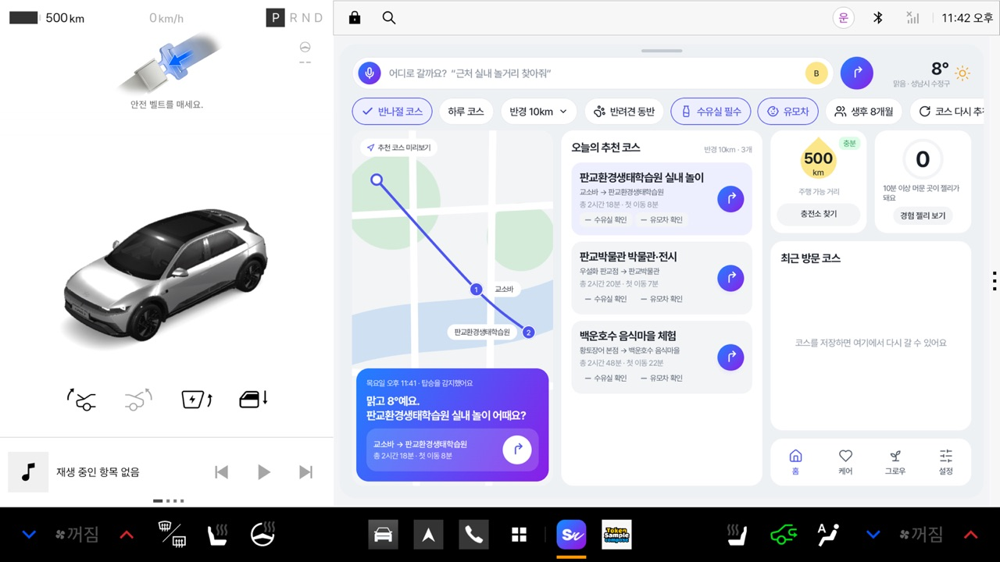
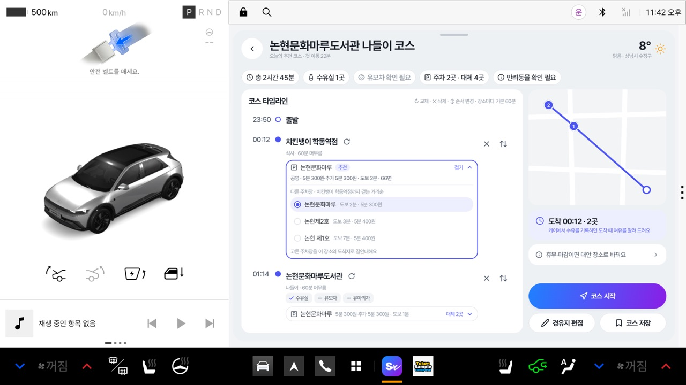
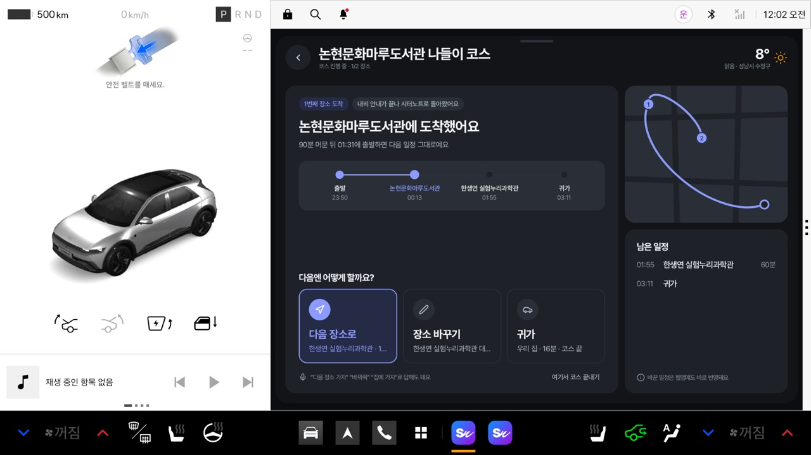
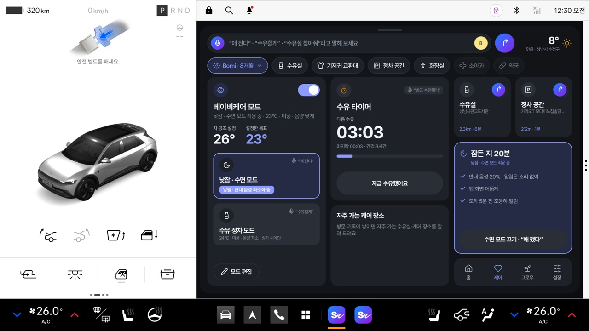
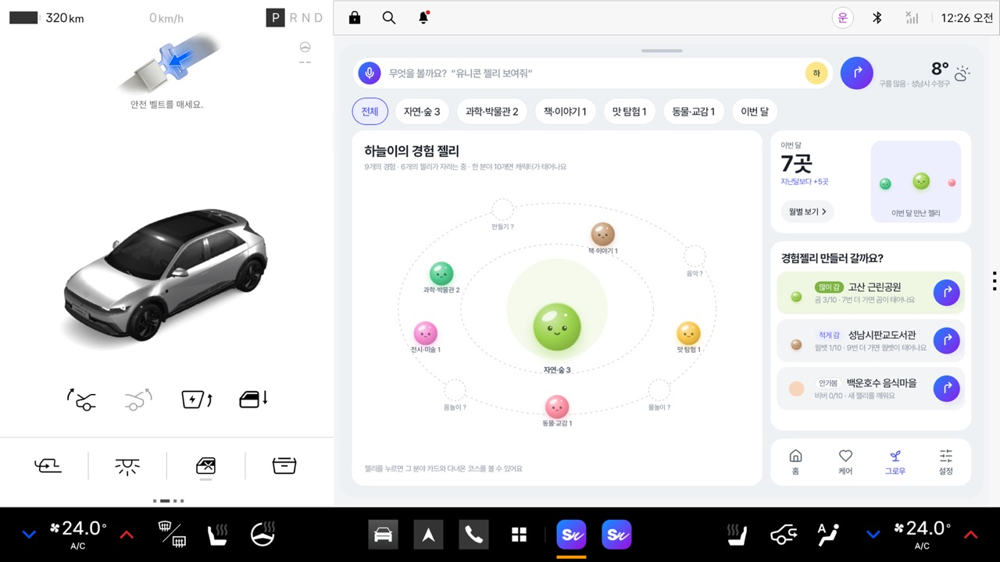
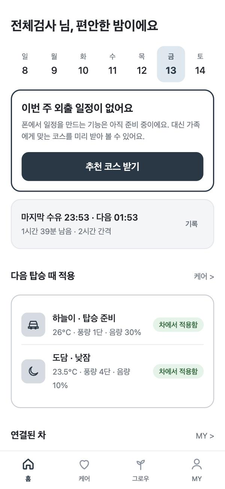

# 차곡 — 아이와의 하루 외출을 차에서 차곡차곡

> **팀 유니콘** · 현대자동차그룹 차량용 앱 개발 공모전 출품작

**차곡**은 영유아와 함께 나서는 가족을 위한 Pleos Connect 차량용 앱입니다. 아이 월령, 수유·낮잠 시간, 차의 위치와 주행 가능 거리를 보고 **식사 → 나들이 → 카페 → 귀가** 하루 코스를 짜 줍니다. 주행 중에는 음성 한마디로 수유실·기저귀 교환대를 경유지에 넣고, 공조·음량을 아이에게 맞춥니다. 다녀온 곳은 아이의 **경험 젤리**로 쌓입니다.

| 홈 · 추천 코스 | 코스 상세 · 주차 | 경유지 도착 |
|---|---|---|
|  |  |  |
| **케어 · 수면 모드** | **그로우 · 경험 젤리** | **폰 웹 (가족 정보·수유 기록)** |
|  |  |  |

## 주요 기능

- **Ready · 코스 추천:** 반경 5~50km 안에서 아이 월령과 실내/야외, 꼭 필요한 시설(수유실·유모차 등)에 맞춰 코스 3개를 추천합니다. 장소마다 기본 60분으로 시각표를 짜고, 주차장(공영주차장 공공데이터)과 대체 장소도 함께 보여 줍니다. 연료가 부족하면 주유소·충전소를 자동으로 경유지에 넣습니다.
- **Care · 함께 돌봄:** 수유 타이머, 수유 임박 시 경로 위 수유실 제안, "애 잔다"·"수유할게" 같은 음성으로 수면 모드(화면 어둡게·안내 음성 낮게·공조)와 수유 정차 모드를 켭니다. 주행 중에는 키보드 입력을 막고 큰 버튼과 음성으로만 답합니다.
- **코스 진행:** Pleos 내비로 안내하고, 장소에 도착하면 다음 장소로 갈지, 장소를 바꿀지, 귀가할지 묻습니다.
- **Grow · 같이 성장:** 10분 이상 머문 장소가 12가지 분야의 경험 젤리로 자라고, 캘린더와 폰 웹에서 함께 봅니다.
- **폰 웹 (`/m/`):** 차 QR로 계정을 연결하고, 아이 정보·수유 기록·케어 모드 값을 폰에서 미리 넣으면 차와 동기화됩니다.

## 실행 방법

### 1. APK 설치 (심사용)

1. Pleos Connect 에뮬레이터를 켭니다(아래 테스트 환경).
2. APK를 설치합니다.
   ```bash
   adb install apk/유니콘_차곡_release.apk
   ```
3. 앱 목록에서 **차곡**을 실행합니다. 첫 화면에서 **[시작하기]** → 권한 허용 → 아이 정보 입력 순서로 온보딩합니다. 계정 없이도 코스 추천·케어·그로우를 쓸 수 있습니다.
4. (선택) 폰 웹과 동기화하려면 브라우저에서 <https://pleos.kwonstar.synology.me/m/signup> 으로 가입한 뒤, 온보딩의 **[웹앱 계정으로 시작 · QR]** 화면 QR을 폰으로 찍어 승인합니다.

APK는 서버 `https://pleos.kwonstar.synology.me/`(팀이 운영하는 서버)를 씁니다. 별도 설정 없이 인터넷만 연결되어 있으면 됩니다.

### 2. 주행 상태 바꾸기

주행 중 화면(키보드 잠금, 1곳 음성 제안)은 Pleos Connect **Virtual Console**에서 기어를 **D**로 바꾸면 볼 수 있습니다. 코스 도착은 Pleos 내비의 주행 시뮬레이션으로 확인할 수 있습니다.

### 3. 소스에서 빌드 (선택)

```bash
cd android
./gradlew assembleDebug                         # 서버: 에뮬레이터에서 본 Mac의 로컬 서버(10.0.2.2:8000)
./gradlew assembleRelease                        # 서버: https://pleos.kwonstar.synology.me/
./gradlew assembleDebug -PserverUrl=https://...  # 다른 서버
```

- JDK 17, Android SDK 35 (minSdk 28)
- release 서명 키는 레포에 없습니다. `android/keystore.properties`가 없으면 서명하지 않은 release가 만들어집니다.

서버를 직접 띄우려면 [`server/README.md`](server/README.md) 와 [`docs/deploy-nas.md`](docs/deploy-nas.md)를 봅니다. Python 3.13, FastAPI, PostgreSQL 17을 쓰고, 루트 `.env`에 아래 키가 필요합니다(값은 레포에 없음).

| 이름 | 용도 |
|---|---|
| `DATA_GO_KR_KEY` | 한국관광공사 TourAPI, 공영주차장·놀이시설·문화시설 공공데이터 |
| `KMA_API_HUB_KEY` | 기상청 날씨 |
| `KAKAO_REST_API_KEY` | 카카오 로컬 검색·길찾기 |
| `ANTHROPIC_API_KEY` | 음성 문장 해석 (없으면 규칙 기반으로 동작) |
| `DATABASE_URL` | PostgreSQL 주소 |

## 테스트 환경

| 항목 | 값 |
|---|---|
| 에뮬레이터 | **Pleos Connect v2.1.0** (AVD `Pleos_Connect_v2.1.0`, 시스템 이미지 `android-34/pleos_car_emulator/arm64-v8a`) |
| Android | 14 (API 34) |
| 화면 규격 | **2560 × 1440, 160dpi** (앱 창 1682 × 1210 기준으로 배치, 분할 화면처럼 좁은 창도 지원) |
| 차량 상태 | Pleos Connect Virtual Console (기어·속도·연료) |
| 개발 도구 | Android Studio, JDK 17, Kotlin · Jetpack Compose, Pleos Connect SDK |
| 서버 | FastAPI + PostgreSQL 17 (Docker, Synology NAS) |

## APK

- 위치: [`apk/유니콘_차곡_release.apk`](apk/유니콘_차곡_release.apk) (release 빌드, 서명됨)
- 패키지: `io.github.haeyeonyou.familytrip` · 버전 1.0.0

## 폴더 구성

| 경로 | 내용 |
|---|---|
| `android/` | 차량 앱 (Kotlin, Jetpack Compose) |
| `server/` | 코스 추천·동기화 API와 폰 웹 `/m/` (FastAPI) |
| `apk/` | 제출용 release APK |
| `docs/` | 디자인 정리, 조사 문서, 작업 기록, 화면 캡처 |
| `tools/` | NAS 배포 스크립트 등 |

## 데이터 출처

한국관광공사 TourAPI, 공공데이터포털(전국 공영주차장·어린이 놀이시설·문화시설·기상청 단기예보), 카카오 로컬·모빌리티 API.
