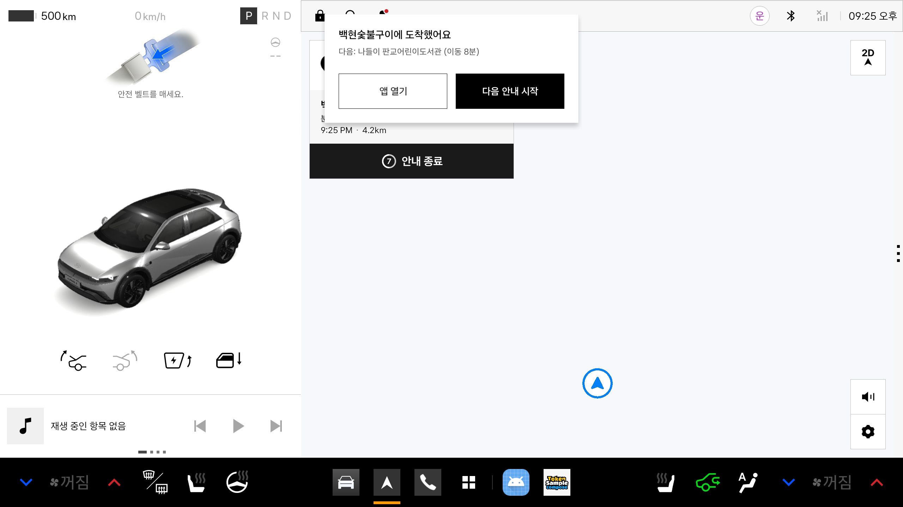
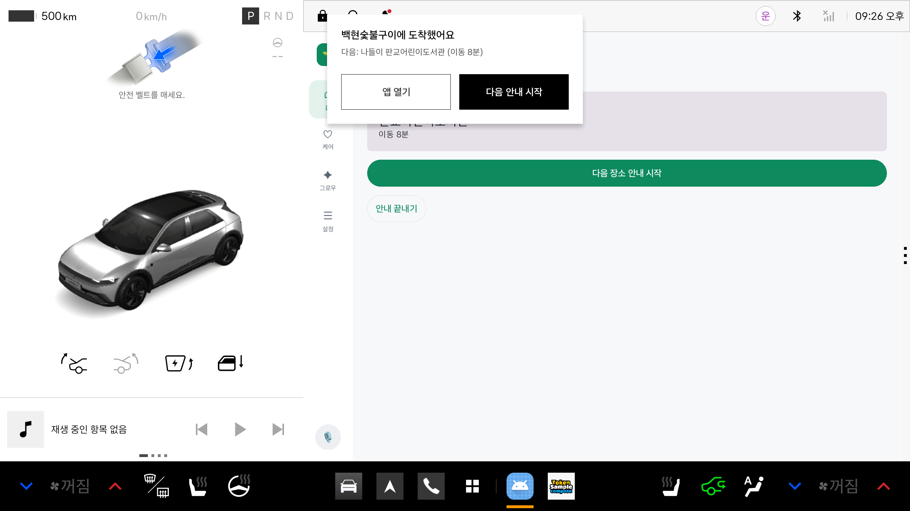
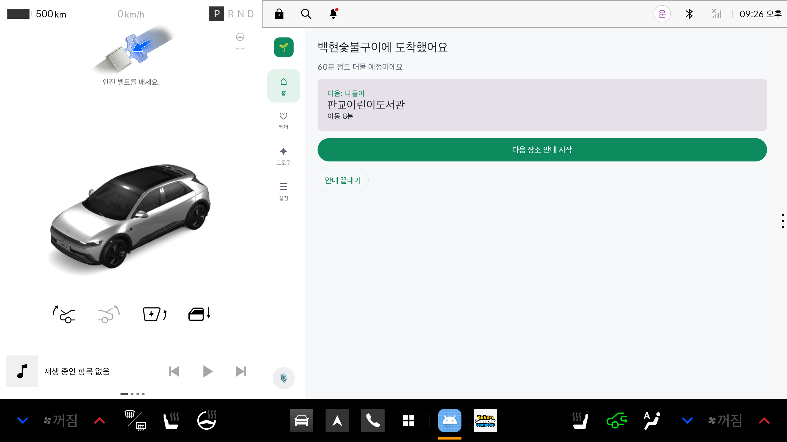

# 목적지 도착 알림과 시동 껐다 켤 때의 상태 보존

작성: 2026-11-08 · 앱 코드(main `50a5b6f`)와 Pleos 에뮬레이터에서 직접 확인한 내용입니다. 실차에서 확인하지 못한 것은 "미확인"이라고 적었습니다.

> 한 줄 요약: 도착 알림과 다음 장소 안내는 이미 **개발자 임시안**으로 동작합니다. 그런데 앱이 꺼지면 코스 진행 상태가 사라지고, 도착 후 화면·알림·재출발 흐름은 기획과 디자인이 없습니다.

---

## 1. 지금 구현된 것 (코드와 에뮬레이터로 확인)

### 안내 시작부터 도착까지
| 단계 | 지금 동작 | 코드 |
|---|---|---|
| 코스 안내 시작 | 첫 장소로 길찾기를 내장 내비에 넘기고 내비를 앞으로 가져옴. 앱은 뒤로 감 | `guide/GuideSession.kt` `guideTo` |
| 안내 중 유지 | 위치 포그라운드 서비스를 띄워 앱이 뒤에 있어도 도착 판정 유지. 상단 상시 알림 "오늘, 어디 가지? 코스 안내 중 · 장소명(으)로 가는 중" (소리 없음) | `guide/GuideService.kt` |
| 도착 판정 | ① 목적지 150m 안 근접(FusedLocation) ② 내비의 `onDestinationArrived` 이벤트. 먼저 오는 쪽을 씀 | `GuideSession.kt`, `location/PleosLocationRepository.kt`, `navi/PleosNaviRepository.kt` |
| 도착 알림 | 헤드업 알림(중요도 높음) "OO에 도착했어요 / 다음: 식사 OO (이동 18분)" + 버튼 **다음 안내 시작**, **앱 열기** | `guide/GuideNotifier.kt` `notifyArrived` |
| 도착 기록 | 방문 기록(도착 시각)을 차 안 파일에 저장. 다음 안내를 시작하면 떠난 시각이 닫힘 → 경험 지도에 반영 | `data/VisitStore.kt` |
| 마지막 장소(귀가) | "오늘 나들이 끝! 집에 도착했어요" 알림, 서비스 종료 | `GuideNotifier.notifyFinished` |
| 다음 장소로 | **자동으로 넘어가지 않음.** 알림 버튼 또는 앱 화면의 "다음 장소 안내 시작"을 눌러야 함 | `GuideActionReceiver`, `ui/GuideScreen.kt` |
| 수면 모드 | 도착 알림이 소리·팝업 없는 조용한 채널로 나가고, 도착 5분 전에 "N분 뒤 도착해요"를 한 번 조용히 알림 | `GuideNotifier.notifyArrivingSoon`, `care/CareController.kt` |
| 수동 도착 | 앱 화면 "도착했어요" 버튼 (알림은 안 뜸) | `GuideSession.markArrived` |

### 앱 안내 화면 (`ui/GuideScreen.kt`)
세 가지 상태(가는 중 / 도착 / 끝)가 큰 글씨와 버튼으로 있는 **임시 화면**입니다. Figma에 대응하는 화면이 없습니다.

### 캡처 (에뮬레이터, 2026-11-08 밤)
이미지는 `docs/arrival-flow/` 에 있습니다.

| 번호 | 내용 | 파일 |
|---|---|---|
| 1 | 홈에서 코스 고르기 | `01-home.png` |
| 2 | 코스 상세(타임라인, 주차 정보) | `02-course-detail.png` |
| 3 | 코스 편집 화면의 "안내 시작" | `03-course-edit.png` |
| 4 | 내비가 앞으로 나온 안내 중 화면 (앱은 뒤에 있음) | `04-navi-driving.png` |
| 5 | 도착 헤드업 알림 (내비 위에 뜸) | `05-arrival-heads-up.png` |
| 6 | 알림이 떠 있는 채로 앱을 열었을 때 (알림이 앱 위를 계속 가림) | `06-heads-up-over-app.png` |
| 7 | 도착 후 앱 안내 화면 (알림을 닫은 뒤) | `07-arrived-screen.png` |

도착 알림에서 직접 확인한 것: 제목 "백현숯불구이에 도착했어요", 본문 "다음: 나들이 판교어린이도서관 (이동 8분)", 버튼 **앱 열기 / 다음 안내 시작**. 알림은 화면 왼쪽 위에 떠서 **내비 안내 버튼과 앱의 좌측 메뉴 일부를 가리고**, 누르거나 닫기 전까지 사라지지 않았습니다(약 15초 이상 확인). 앱을 열어도 그대로 남았습니다. 닫으면 상단 바에 종 모양(읽지 않음) 표시만 남습니다.

---

## 2. 실제로 확인한 문제

1. **앱이 꺼지면 코스 진행이 사라집니다.** 안내 상태(`GuideState`: 코스 정류장 목록, 지금 몇 번째, 도착 여부)는 메모리에만 있고 파일에 저장되지 않습니다. 오늘 밤 다른 작업으로 앱이 재설치되자 포그라운드 서비스가 꺼지고, 앱을 열면 **홈으로 돌아와 있었습니다.** 안내 중이던 코스를 이어서 할 방법이 없습니다.
2. **"머무는 중" 방문이 열린 채 남습니다.** 도착 기록은 파일에 남지만, 떠난 시각은 "다음 안내 시작"을 눌러야 닫힙니다. 앱이 꺼지면 영영 열려 있습니다.
3. **앱이 뒤로 가면 시스템이 앱을 얼립니다(freeze).** 포그라운드 서비스가 없으면 도착 이벤트를 받지 못합니다. 지금은 안내 중에만 서비스를 유지해서 막고 있고, 서비스가 죽으면 같이 무너집니다.
4. **버그: 알림 번호가 겹칩니다.** 상시 알림과 "N분 뒤 도착해요" 알림이 같은 번호(2)를 씁니다. 수면 모드에서 도착 예고가 뜨면 상시 알림을 덮어씁니다. (수정 예정, 기획과 무관)
5. **다음 장소로 가는 흐름이 사람에게 달려 있습니다.** 아이 때문에 정신이 없을 때 "다음 안내 시작"을 안 누르면 계속 도착 상태로 남습니다.
6. **도착 헤드업 알림이 사라지지 않고 화면을 가립니다.** 에뮬레이터에서 알림이 왼쪽 위를 덮은 채로 15초 넘게 남았고, 앱을 열어도 앱 위에 그대로 있었습니다(캡처 05, 06). 아이를 챙기느라 손이 바쁜 상황에서 주행 중 내비 버튼을 가리면 문제가 됩니다. 몇 초 뒤 자동으로 접히게 할지(헤드업 대신 조용한 알림으로 전환) 정해야 합니다. 실차에서 같은 동작인지는 미확인입니다.
7. (별개) 홈의 "다음 수유까지" 카드에서 시간이 길어지면 글자가 겹칩니다.

---

## 3. 어디까지 구현이 가능한가

| 하고 싶은 것 | 가능 여부 | 근거·제약 |
|---|---|---|
| 도착하면 앱이 뒤에 있어도 알림 | **가능, 이미 됨** | 위치 포그라운드 서비스 + 내비 도착 이벤트. 에뮬레이터에서 확인 |
| 알림에 버튼(다음 안내, 앱 열기, 더 머물기 등) | **가능** | 알림 액션은 코드 몇 줄 |
| 화면 위에 큰 팝업(다른 앱 위에 표시) | **불가** | Pleos에 "다른 앱 위에 표시" 권한 설정이 없음. 알림으로만 가능 (#38) |
| 도착 알림을 음성으로 읽어 주기 | **가능** | Pleos TTS SDK 사용 중. 수면 모드는 음량 30% 규칙 이미 있음 |
| 앱이 꺼져도 코스 진행 상태 보존 | **가능** | 진행 상태를 파일에 저장하고 앱 시작 때 복원하면 됨. 지금 안 되어 있을 뿐 |
| 시동을 끄고 켰을 때 "이어서 갈까요?" | **부분 가능** | 시동 자체를 알려 주는 SDK 값은 **없음**. 대신 기어가 P에서 D로 바뀌는 것(앱이 이미 `isParked`로 읽음)이나 앱 시작을 신호로 쓸 수 있음 |
| 정차 중(시동 꺼짐) 머무는 시간 알림 | **조건부** | 시동이 꺼지면 차량 SDK와 앱이 계속 도는지 **미확인**. 차가 꺼진 동안 앱이 살아 있다고 가정하면 안 됨 |
| 출발 시각이 되면 알림 | **조건부** | 위와 같은 이유로 시동이 꺼진 동안은 못 울릴 수 있음. 대안: 시동 켜자마자 "다음 장소 출발할까요?" |
| 휴대폰으로 상태 공유 | **가능(서버 필요)** | 서버에 진행 상태를 올리면 가능. 현재는 안 만들었음 |

미확인 항목(실차 또는 Pleos 측 확인 필요): 시동 off 때 앱 프로세스가 죽는지 / 시동 on 때 앱이 자동으로 다시 뜨는지 / 주행 중 헤드업 알림이 주행 방해 방지 정책으로 가려지는지.

---

## 4. 기획에 묻고 싶은 것

**A. 시동이 꺼졌다 켜질 때**
1. 목적지에 도착해 시동을 끄고, 몇 시간 뒤 다시 켰을 때 **무엇을 보여 줘야 하나요?** (a) 자동으로 "다음 장소로 갈까요?" 화면 (b) 홈에서 "이어서 안내하기" 카드 (c) 아무것도 안 함
2. "코스를 이어간다"의 기준은? 도착 후 몇 시간까지 이어서 보여 주고, 그 뒤에는 코스를 닫나요? (예: 다음 날이 되면 자동 종료)
3. 장소에서 일찍 출발하거나, **계획에 없던 곳에 들렀다가** 다시 시동을 켰을 때는 어떻게 하나요? (건너뛰기 / 코스 재조정)
4. 아이가 잠들어 있는 동안 시동을 껐다 켜는 경우, 수면 모드는 유지하나요?

**B. 도착했을 때**
5. 도착 알림에 **어떤 정보**가 있어야 하나요? (장소명, 머무는 시간, 다음 장소·이동 시간, 주차 위치, 수유실·유모차 정보 등)
6. 도착 알림에서 **어떤 행동**을 하게 하나요? 지금은 "다음 안내 시작 / 앱 열기"뿐입니다. (예: 더 머물기, 건너뛰기, 수유 기록하기, 주차 위치 저장)
7. 주행 중에도 알림 버튼을 눌러도 되나요? (이전 결정: 버튼은 허용, 키보드 입력만 금지)
8. 도착 알림을 **음성으로도 읽어 주나요?** 수면 모드에서는 소리 없이 어떻게 알릴까요?
9. 도착 5분 전 예고를 **수면 모드가 아닐 때도** 줄까요?

**C. 머무는 동안, 출발할 때**
10. 머무는 시간(예: 60분)이 끝나기 전 "곧 출발할 시간이에요" 알림이 필요한가요? 필요하면 몇 분 전에?
11. 다음 수유 시각이 머무는 시간 중에 오면 도착 알림에 함께 보여 주나요?
12. 출발은 **사용자가 눌러야** 하나요, 시동이 켜지면 **자동으로** 다음 내비를 시작하나요? (자동이면 가족이 원치 않는 길안내를 시작할 위험이 있음)
13. 정차한 동안 날씨가 급변하거나 장소 휴무를 알게 되면 알려 주나요?

**D. 끝났을 때**
14. 마지막 장소(귀가) 도착 후 화면에는 무엇을 보여 주나요? (오늘의 기록, 경험 나무 반영, 후기 입력)
15. 코스를 중간에 **끝내는 흐름**은? 지금은 "안내 끝내기" 버튼뿐입니다.

## 5. 디자이너에게 묻고 싶은 것

1. 앱의 **안내 중 화면**(내비가 앞이고 앱이 뒤일 때 돌아오면 보이는 화면) 디자인이 있나요? 지금은 큰 글씨 텍스트와 버튼으로만 된 임시안입니다. (가는 중 / 도착 / 끝 세 상태)
2. 도착 알림이 **헤드업으로 뜨는 짧은 순간**에 보일 문구와 버튼 구성은? 차량 알림 영역이 좁아서 제목 1줄 + 본문 1줄 + 버튼 2개가 한계입니다. 지금은 알림이 내비 버튼 위를 덮고 오래 남아 있어서(캡처 05), 몇 초 뒤 접히는 상태와 접힌 뒤 어디에 보일지(상단 바 종 모양)도 필요합니다.
3. 수면 모드일 때 알림과 앱 화면의 톤(밝기, 색)은 어떻게 다르게 하나요?
4. "이어서 안내할까요?" 같은 **복귀 화면**을 새로 그려 주실 수 있나요? 홈 상단 카드로 둘지 전체 화면으로 둘지.
5. 도착 후 **정차 화면**(머무는 시간 타이머, 다음 장소 미리보기, 주차·수유실 정보)이 필요한가요?
6. 상시 알림(안내 중 상단에 계속 떠 있는 것)의 문구와 아이콘은? 지금은 안드로이드 기본 지도 아이콘입니다.
7. 헤드업 알림이 **주행 중 가려질 수 있어서**, 그 경우 대체 표시(앱 아이콘 배지, 음성)를 어디까지 디자인할까요?

---

## 6. 개발 쪽 제안 (기획 답변과 상관없이 먼저 해도 되는 것)
- 코스 진행 상태를 파일에 저장하고 앱 시작 때 복원 (어떤 화면을 보여 줄지는 기획 A1 답변 후)
- 상시 알림과 도착 예고 알림 번호 충돌 수정
- 열려 있는 방문 기록은 앱 복원 시 정리

기획 답변이 오면 위 A~D 중 정해진 것부터 별도 세션으로 구현하겠습니다.
