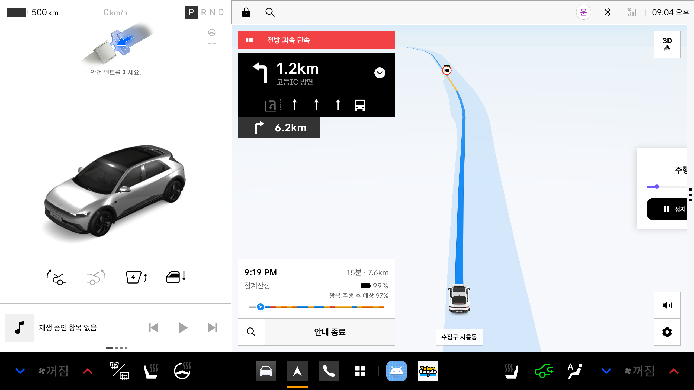
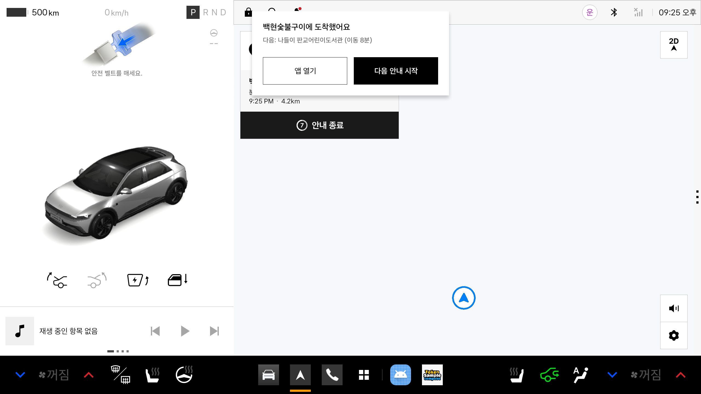
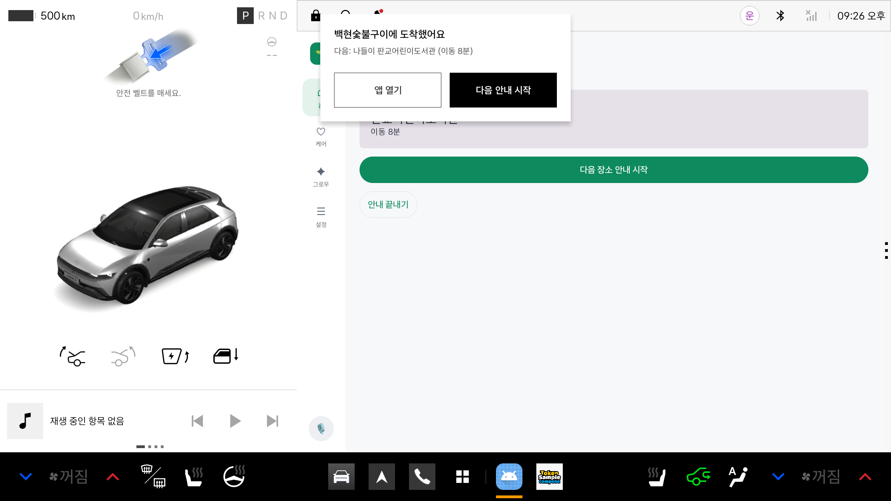
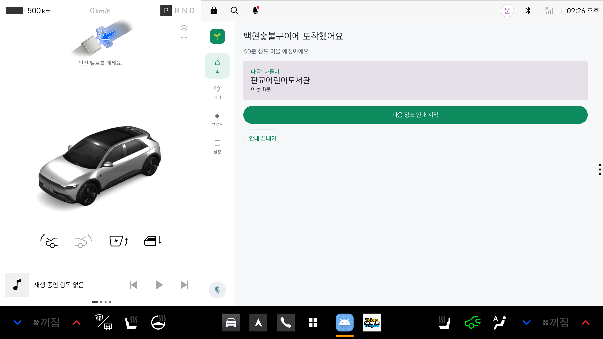

# 기획·디자인에 묻고 싶은 것: 도착할 때, 그리고 시동을 껐다 켤 때

코스를 따라 A → B → C → D로 이동하면, 장소마다 시동을 끄고 내려서 한참 있다가 다시 시동을 켜고 출발하게 됩니다. 그런데 이때 앱이 **무엇을 보여 주고 어떻게 행동해야 하는지**가 기획에도, 디자인에도 없습니다. 지금 화면은 개발하면서 임시로 만든 것입니다. 아래 그림을 보고 정해 주시면 그대로 만들겠습니다.

화면 캡처는 이 문서 안에 들어 있고, 원본은 `docs/arrival-flow/` 폴더에도 있습니다. 시작 화면(홈, 코스 상세, 코스 편집)은 [01](arrival-flow/01-home.png), [02](arrival-flow/02-course-detail.png), [03](arrival-flow/03-course-edit.png)입니다.

---

## 지금 앱이 하는 일 (임시안)

1. 코스를 시작하면 첫 장소로 길안내가 시작되고, 앱은 뒤로 물러납니다.
2. 목적지 근처에 오면 화면 왼쪽 위에 **작은 알림 팝업**이 뜹니다. (캡처 05)
   - 제목: "○○에 도착했어요"
   - 내용: "다음: 나들이 ○○ (이동 8분)"
   - 버튼 두 개: **앱 열기** / **다음 안내 시작**
3. 앱을 열면 도착 안내 화면이 나옵니다. (캡처 07) "○○에 도착했어요 / 60분 정도 머물 예정이에요 / 다음 장소 안내 시작 / 안내 끝내기"
4. **다음 장소로 가려면 누군가 버튼을 눌러야 합니다.** 저절로 넘어가지 않습니다.

**① 코스를 시작하면 내비가 앞으로 나오고, 앱은 뒤로 물러납니다**

**② 목적지에 도착하면 왼쪽 위에 알림 팝업이 뜹니다** (캡처 05)

**③ 앱을 열면 도착 안내 화면이 나옵니다. 팝업이 닫히지 않으면 이렇게 앱 위를 가립니다** (캡처 06)

**④ 팝업을 닫은 뒤의 도착 안내 화면** (캡처 07)

## 지금 불편한 점

- **알림 팝업이 사라지지 않고 화면을 가립니다.** 내비 버튼과 앱 메뉴 일부를 덮은 채 누르기 전까지 계속 떠 있었습니다. (캡처 05, 06)
- **앱이 꺼졌다 켜지면 코스가 처음부터 없어집니다.** 도착해서 시동을 끄고, 돌아와 다시 켜면 "아까 그 코스"를 앱이 기억하지 못하고 홈 화면으로 돌아갑니다.
- 도착 알림에서 할 수 있는 행동이 "다음으로 가기"와 "앱 열기"뿐입니다.

---

## 기획에게

아래 질문은 가능하면 "이럴 때는 이렇게"로 한 줄씩만 답해 주셔도 충분합니다. 괄호 안은 제가 생각한 예시입니다.

### 1. 시동을 껐다 켰을 때

**상황:** 식당에 도착해서 시동을 끄고 1시간 식사한 뒤, 시동을 다시 켰습니다.

1. 시동을 켜면 앱이 **어떻게 반응**해야 하나요?
   - (a) 바로 "다음 장소로 갈까요?" 큰 화면을 보여 준다
   - (b) 홈 화면 맨 위에 "이어서 가기" 카드만 보여 준다
   - (c) 아무것도 안 하고 사용자가 직접 앱을 연다
2. 코스는 **언제까지 이어서** 보여 줄까요? (예: 도착 후 6시간, 또는 밤 12시가 지나면 자동으로 끝)
3. 코스에 없던 곳에 들렀거나, 장소를 하나 건너뛰고 싶을 때는 어떻게 하나요? (예: "건너뛰기" 버튼, 또는 다음 장소를 새로 정하기)
4. 아이가 자는 동안 시동을 껐다 켠 경우, **수면 모드(조용한 모드)는 그대로 유지**하나요?

### 2. 도착했을 때

5. 도착 알림에 **꼭 있어야 하는 정보**는 무엇인가요? 지금은 장소 이름과 다음 장소만 있습니다. (예: 주차한 위치, 수유실·유모차 정보, 머무는 시간, 다음 수유 시각)
6. 도착 알림에서 바로 **누를 수 있는 버튼**은 무엇이 좋을까요? 지금은 "다음 안내 시작", "앱 열기" 두 개입니다. (예: "더 머물기", "건너뛰기", "수유 기록하기", "주차 위치 저장")
7. 알림을 **소리로도 읽어 줄까요?** 아이가 자고 있을 때는 소리 없이 어떻게 알릴까요? (예: 화면만 조용히 알림)
8. 도착 **5분 전에 미리 알려 주는 기능**이 지금은 아이가 잘 때만 있습니다. 평소에도 필요할까요?

### 3. 머무는 동안, 그리고 출발할 때

9. 머무는 시간(예: 60분)이 거의 끝나면 "곧 출발할 시간이에요"라고 알려 줄까요? 알려 준다면 몇 분 전이 좋을까요?
10. 머무는 동안 **수유 시간**이 오면 도착 알림이나 화면에 함께 보여 줄까요?
11. 출발은 사람이 **직접 누르게** 할까요, 시동을 켜면 **자동으로** 다음 길안내를 시작할까요? (자동으로 하면 편하지만, 가족이 원치 않을 때 길안내가 먼저 시작될 수 있습니다.)
12. 머무는 중에 날씨가 급하게 나빠지거나 다음 장소가 쉬는 날인 걸 알게 되면 알려 줄까요?

### 4. 마지막에

13. 마지막 장소(집)에 도착하면 어떤 화면을 보여 줄까요? (예: 오늘의 기록, 아이 경험 나무에 쌓인 것, 후기 남기기)
14. 코스를 **중간에 끝내고 싶을 때**는 어떻게 하나요? 지금은 "안내 끝내기" 버튼 하나뿐입니다.

> 참고로 차에서 **시동이 켜졌는지 꺼졌는지를 앱이 직접 알 수는 없습니다.** 대신 "기어가 주차(P)에서 바뀌었다"거나 "앱이 다시 열렸다"를 신호로 삼는 방식으로 만들 수 있습니다. 시동이 꺼진 동안 앱이 계속 켜져 있는지는 실제 차에서 확인해야 합니다. 그래서 "시동이 꺼진 동안 알림을 울리는" 기능은 약속드리기 어렵고, "시동을 켜는 순간 알려 주는" 쪽이 안전합니다.

---

## 디자이너에게

1. **안내 중 화면**이 있나요? 길안내 중에는 내비가 앞에 있고, 앱은 알림이나 앱 아이콘으로 돌아왔을 때만 보입니다. 지금은 큰 글씨와 버튼만 있는 임시 화면입니다. "가는 중 / 도착 / 마지막 도착" 세 가지 모습이 필요합니다. (캡처 07)
2. **도착 알림 팝업**의 모양을 그려 주실 수 있나요? 차 화면에서는 알림 자리가 좁아서, 제목 한 줄 + 설명 한 줄 + 버튼 두 개 정도가 한계입니다. (캡처 05)
3. 그 팝업이 **몇 초 뒤 저절로 접혀야** 할 것 같습니다. 지금은 내비 버튼을 계속 가립니다. 접힌 뒤에는 어디에 어떻게 남겨 둘까요? (지금은 위쪽 바에 종 모양 점만 남습니다.)
4. **수면 모드(아이가 잘 때)**의 알림과 앱 화면은 일반 모드와 어떻게 달라야 하나요? (밝기, 색, 크기)
5. 시동을 다시 켰을 때 보일 **"이어서 갈까요?" 화면**을 새로 그려 주실 수 있나요? 홈 맨 위의 작은 카드가 좋을지, 화면 전체가 좋을지 정해 주세요.
6. 도착 후 **머무는 동안 보일 화면**이 필요한가요? (남은 머무는 시간, 다음 장소 미리보기, 주차·수유실 정보)
7. 안내 중 위쪽에 계속 떠 있는 **작은 상태 알림**("코스 안내 중 · ○○로 가는 중")의 문구와 아이콘도 정해 주세요. 지금은 기본 지도 아이콘입니다.
8. 알림 팝업이 **주행 중에는 안 보일 수도** 있습니다. 그때를 대비해 대신 보여 줄 것(앱 아이콘 표시, 음성 안내 등)을 어디까지 디자인할지 정해 주세요.

---

## 답변이 오면

정해진 것부터 하나씩 만들고, 아래 두 가지는 기획 답변과 상관없이 먼저 고치겠습니다.
- 앱이 꺼져도 코스가 이어지도록 진행 상태를 저장하기
- 알림이 서로 덮어쓰는 문제 고치기
