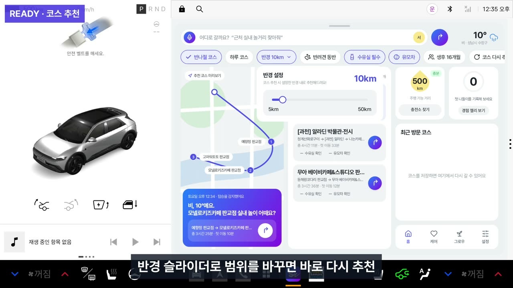
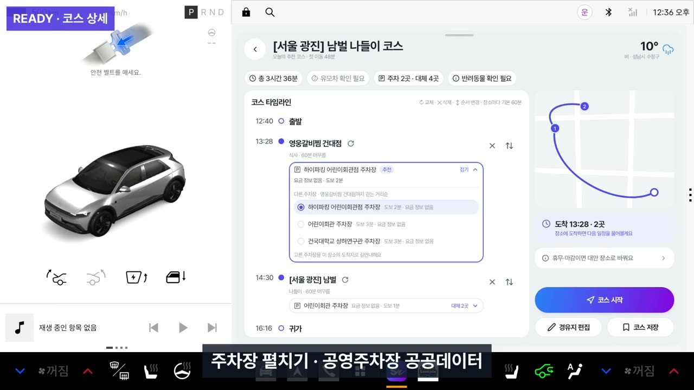
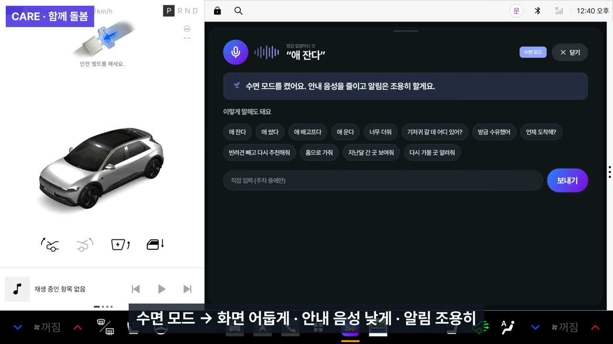
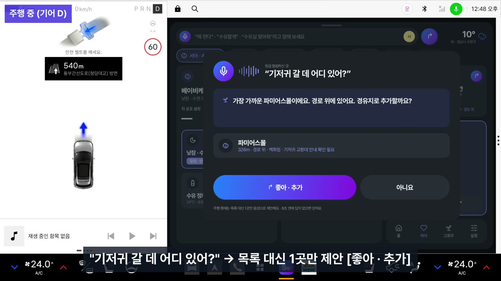
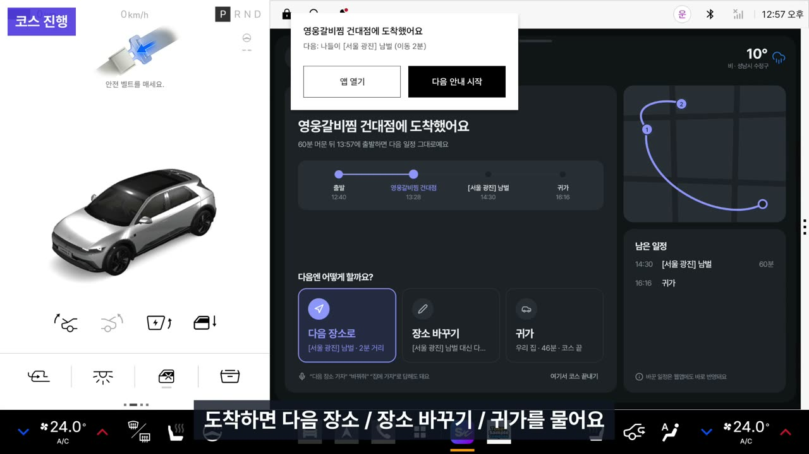
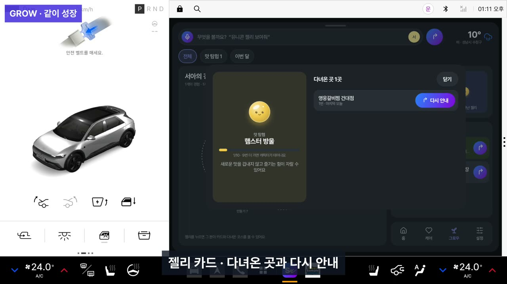

# 차곡 시연 영상 (1차 접수용)

- 영상 파일: 레포 밖 `~/Movies/chagok-demo/유니콘_차곡_시연영상.mp4` (레포에는 넣지 않음. YouTube 등 업로드는 사용자가 정함)
- 규격: 1920×1080, H.264(무음 AAC 트랙 포함), 30fps, **4분 48초**, 약 9.9MB
- 촬영: 2026-11-14, Pleos Connect v2.1.0 에뮬레이터(2560×1440)에서 `adb shell screenrecord --size 1920x1080`으로 장면별 녹화
- 앱: 제출 APK `apk/유니콘_차곡_release.apk`(서버 `https://pleos.kwonstar.synology.me/`)를 새로 설치한 상태에서 계정 없이 실제로 조작. 꾸민 데이터 없음
- 조작: `adb shell input tap` / 기어는 Virtual Console(`PUT /vehicle/gear`) / 도착은 Pleos 내비 주행 시뮬레이션을 실제 시간으로 기다림 / 음성은 음성 패널의 문장 버튼(에뮬레이터라 실제 마이크 대신)
- 기다린 구간(내비 주행 약 15분, 첫 장소에 12분 머묾)은 편집에서 잘라 내고 자막·카드로 알림. 일부 장면은 2~5배속(자막에 표기)
- 자막: Pretendard Bold, 화면 아래 큰 자막 + 왼쪽 위 기능 태그(READY / CARE / GROW / 주행 중 / 코스 진행). 음성 해설 없음
- 화면에 계정·QR·개인정보 없음(아이 이름 '서아', '도윤'은 시연용으로 입력한 이름)

## 장면 목록·시간표·자막 원고

| 시간 | 장면 | 태그 | 자막 |
|---|---|---|---|
| 0:00–0:05 | 제목 카드 | — | 차곡 / 아이와의 하루 외출을 차에서 차곡차곡 / 팀 유니콘 · Pleos Connect 차량용 가족 나들이 앱 / Pleos Connect 에뮬레이터 실제 조작 녹화 · 제출 APK · 실서버 |
| 0:05–0:34 | 온보딩 O01→권한→아이 정보→준비 완료 (5배속) | 시작 · 온보딩 | 계정 없이 [시작하기]로 바로 써요 · 차량 정보 · 위치 · 마이크 · 알림 권한 · 아이 이름과 생년월일 → 월령 자동 계산 · 아이 맞춤 준비 완료 (5배속) |
| 0:34–0:58 | 홈 추천 코스 3개, 반경 슬라이더 (2배속) | READY · 코스 추천 | 날씨 · 주행 가능 거리 · 아이 월령으로 오늘의 코스 3개 · 반경 슬라이더로 범위를 바꾸면 바로 다시 추천 |
| 0:58–1:26 | 코스 상세: 장소마다 60분, 주차 펼침, 대체 장소 | READY · 코스 상세 | 장소마다 기본 60분으로 짠 하루 시각표 · 주차장 펼치기 · 공영주차장 공공데이터 · 장소마다 대체 장소 후보 (경로 위 · 같은 조건) |
| 1:26–1:40 | 코스 시작 → Pleos 내비 경로 | 코스 진행 | 코스 시작 → Pleos 내비로 바로 안내 |
| 1:40–1:50 | 케어 화면, 베이비케어 켜기, 음성 패널 | CARE · 함께 돌봄 | 음성 "애 잔다" (에뮬레이터라 문장 버튼으로 입력) |
| 1:50–2:07 | 수면 모드(화면 어둡게) | CARE · 함께 돌봄 | 수면 모드 → 화면 어둡게 · 안내 음성 낮게 · 알림 조용히 |
| 2:07–2:20 | 둘째 아이 추가 (5배속) | CARE · 함께 돌봄 | 형제 · 자매도 따로 등록, 케어 값은 아이마다 (5배속) |
| 2:20–2:50 | 수유 타이머(마지막 수유 시각), 수유실 3곳 (2배속) | CARE · 함께 돌봄 | 수유 타이머 · 마지막 수유 시각을 고르면 다음 수유 예상 · 경로 위 가까운 수유실 3곳 · [경유지 추가] |
| 2:50–2:57 | 기어 D | 주행 중 (기어 D) | Virtual Console에서 기어 D · 주행 중 화면 |
| 2:57–3:05 | 음성 "기저귀 갈 데 어디 있어?" → 1곳 제안 | 주행 중 (기어 D) | "기저귀 갈 데 어디 있어?" → 목록 대신 1곳만 제안 [좋아 · 추가] |
| 3:05–3:16 | 설정: 주행 중 키보드 잠금 안내 | 주행 중 (기어 D) | 주행 중엔 키보드 입력을 막고 버튼과 음성으로만 |
| 3:16–3:34 | 도착 5분 전 조용한 알림 | 코스 진행 | 내비 주행 시뮬레이션 약 15분은 생략했어요 · 아이가 자는 중이면 도착 5분 전에 조용히 알려 줘요 |
| 3:34–4:01 | H03 도착, 장소 바꾸기 후보 (1.5배속) | 코스 진행 | 도착하면 다음 장소 / 장소 바꾸기 / 귀가를 물어요 · 장소 바꾸기 → 같은 시간대 대체 후보 |
| 4:01–4:04 | 카드 | — | 그곳에서 12분 머문 뒤 / 실제로 기다린 시간은 편집에서 줄였어요 |
| 4:04–4:16 | H04 코스 종료(12분 머묾, 젤리 1개) | GROW · 같이 성장 | 코스 종료 · 10분 이상 머문 곳이 경험 젤리로 자라요 |
| 4:16–4:42 | G01 그로우, 젤리 카드, G03 캘린더, 홈 타일 (2배속) | GROW · 같이 성장 | 그로우 · 12가지 분야의 경험 젤리 · 젤리 카드 · 다녀온 곳과 다시 안내 · 캘린더로 보는 한 달 · 홈 타일에도 반영 |
| 4:42–4:48 | 마무리 카드 | — | 차곡 · 팀 유니콘 / github.com/HaeyeonYou/pleos-family-trip-planner / 폰 웹 pleos.kwonstar.synology.me/m/ / APK: GitHub Release v1.0.0 |

## 대표 프레임

| | |
|---|---|
|  |  |
|  |  |
|  |  |

## 빠진 장면

- 폰 웹(`/m/`)과 QR 계정 연결: 계정 로그인·가입을 하지 않는 조건이라 찍지 않음(마무리 카드에 주소만).
- 수유 임박 시 자동으로 뜨는 "경로 위 수유실" 제안(C06): 수유 간격이 3시간이라 임박 상태까지 기다리지 않음. 대신 수유실 칩으로 목록을 보여 줌. [경유지 추가]는 누르지 않음.
- 귀가 구간 주행: 두 번째 장소로 안내를 시작한 뒤 "여기서 코스 끝내기"로 마침.

## 다시 만들기

녹화 원본과 편집 스크립트는 레포에 두지 않았다(촬영 세션 임시 폴더). 같은 방식으로 다시 찍으려면 `docs/agent-tasks/1114-demo-video.md` 진행 로그를 본다.
