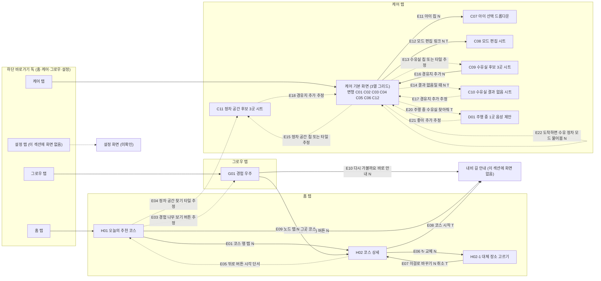

# 11/10 확정 디자인 — 화면 흐름 · 컴포넌트 관계 · 상태

대상: Figma 파일 `xeLwkzhH8tnsazQdOriGU2` 페이지 `종합 정리`(130:5)의 섹션 `11/10 · Pleos 공통 UI + 지수ver`(351:2611).
읽은 날짜: 2026-11-10. 읽는 방법: 17개 화면 스크린샷을 모두 눈으로 보고, 글자·구조·색·위치는 `use_figma`(읽기 전용)로 노드에서 읽었다.

이 문서의 목적: 다른 세션의 개발자가 이 문서만 읽고 "어떤 화면이 언제 어떻게 바뀌는지, 어떤 컴포넌트가 어디에 다시 쓰이는지"를 이해하도록 한다.

## 0. 읽는 법

### 0.1 근거 표기

모든 항목 끝에 근거를 `[종류:노드id]`로 붙였다.

| 표기 | 뜻 | 신뢰 |
|---|---|---|
| `[N:id]` | 디자이너 Note 텍스트(357:1716~1732)에 적힌 말 | 사실(디자이너 의도) |
| `[T:id]` | 화면 안에 그려진 글자(버튼·안내문 등) | 사실(그려진 것) |
| `[V:id]` | 구조·위치·색·표시 여부·인스턴스 관계 등 노드 속성 | 사실(그려진 것) |
| `[추정]` | 위 근거가 직접 말하지 않아 내가 해석한 것 | 구현 전에 기획 확인 필요 |
| `미확인` | 디자인에 없거나 읽지 못함 | 값을 만들지 않음 |

### 0.2 프로토타입 연결은 없다 (중요)

섹션 351:2611 안의 모든 노드(7,375개)를 `node.reactions`로 검사했더니 **프로토타입 연결(reactions)이 하나도 없다**. 따라서 화살표의 근거는 Note, 화면 안 글자, 시각 단서뿐이다. "버튼 X를 누르면 화면 Y"로 확정된 것은 Note가 직접 말한 것(`N`)뿐이고, 나머지는 `[추정]`이다. [V:351:2611 전체 검사]

### 0.3 코드 K3~K14, HF03-1의 정체

Note에 나오는 `K3, K4, K5, K6, K7, K7-2, K8, K13, K14`는 기획 쪽 기능 번호로 보이나 **레포 안에서 대응 문서를 찾지 못했다**(`docs/`·`AGENTS.md` 검색에 K번호 정의 없음). `[추정]` 기획 기능 번호. 다만 `HF03-1`(C08 Note)은 레포 문서에 나온다: `docs/research/web-server-contract.md`가 "케어 화면(Figma HF03 v2)"과 "HF03-1 편집 창"을 베이비케어 모드 카드·모드 편집 창으로 설명한다. 즉 HF는 이전 Figma 화면 번호(고해상도 화면)로 보이고 HF03-1 = 모드 편집 창이다. 같은 방식으로 설정 화면은 `HF05`(Figma 노드 210:1031, `docs/settings-hf05.md`)다.

---

## 1. 앱 전체 화면 지도

### 1.1 화면 17장 한눈에 보기

모든 화면은 1920x1080 프레임 하나에 (a) 공통 UI 셸 인스턴스 `Pleos 공통 UI`와 (b) 앱 프레임 `App · 시터노트`(1256x886, 위치 652,76, 모서리 32, 클립)가 들어 있다. [V:352:2747 외 14곳 동일]

| 화면 | 프레임 id | 탭(독에서 파란색) | 셸 변형 | 앱 배경 | 이 화면이 보여 주는 것 |
|---|---|---|---|---|---|
| H01 홈 | 352:2601 | 홈 [V:352:3007] | Light·Off (인스턴스 352:2602) | #eef1f4 | 지도 카드+추천 코스 3개+정차 공간 타일+경험 나무 타일+최근 방문 코스 |
| H02 코스 상세 | 353:2745 | 독 없음 | Light·Off (353:2746) | #eef1f4 | 타임라인+지도+도착·수유 상태+버튼 3개 |
| H02-1 대체 장소 | 353:3066 | 독 없음 | Light·Off (353:3067) | #eef1f4 | H02에서 오른쪽 열이 대체 장소 시트로 바뀜 |
| G01 그로우 | 354:3033 | 그로우 [V:354:3301] | Light·Off (354:3034) | #eef1f4 | 경험 우주 그래프+이번 달/새 분야 타일+다시 가볼까요 |
| C01 케어 · 도착 지연 알림 | 355:3177 | 케어 [V:355:3549] | Light·Off (355:3178) | #eef1f4 | 케어 기본+오른쪽 슬롯에 지연 알림 |
| C02 케어 · 첫 기록 전 | 355:3567 | 케어 | Light·Off (355:3568) | #eef1f4 | 타이머가 빠른 선택으로, 슬롯이 빈 상태 안내 |
| C03 케어 · 수유 정차 모드 | 355:3942 | 케어 | Light·Off (355:3943) | #eef1f4 | 모드 카드·타이머·슬롯이 "수유 중"으로 |
| C04 케어 · 낮잠·수면 (다크) | 355:4322 | 케어 | **Dark·Off** (355:4323, 351:2758) | **#121418** | 다크+수면 모드 슬롯 |
| C05 케어 · 수유 임박 | 355:4702 | 케어 | Light·Off (355:4703) | #eef1f4 | 타이머 주황+슬롯에 임박 카드 |
| C06 케어 · 수유 지남 | 355:5094 | 케어 | Light·Off (355:5095) | #eef1f4 | 타이머 빨강+슬롯에 지남 카드 |
| C07 아이 선택 펼침 | 356:4041 | 케어 | Light·Off (356:4042) | #eef1f4 | scrim+드롭다운 |
| C08 모드 편집 | 356:4452 | 케어 | Light·Off (356:4453) | #eef1f4 | scrim+시트(배경은 C01 상태) |
| C09 수유실 후보 | 356:4897 | 케어 | Light·Off (356:4898) | #eef1f4 | scrim+시트 3곳(배경은 C01 상태) |
| C10 수유실 결과 없음 | 356:5359 | 케어 | Light·Off (356:5360) | #eef1f4 | scrim+시트(정차 공간 2곳) |
| C11 정차 공간 후보 | 356:5796 | 케어 | Light·Off (356:5797) | #eef1f4 | scrim+시트 3곳 |
| C12 경유지 추가 완료 | 356:6254 | 케어 | Light·Off (356:6255) | #eef1f4 | 위쪽 토스트+슬롯이 다음 경유지 카드로 |
| D01 주행 중 1곳 제안 | 356:6661 | 케어 | **Light·On** (356:6662, 351:2903) | #eef1f4 | scrim+가운데 음성 제안 패널 |

(그 밖에 `Type · Pretendard 위계` 357:1733은 화면이 아니라 글자 위계 표다. 이 문서 범위 밖.)

- 독(Nav · 바로가기)은 H01, G01, C01~C12, D01에 있고 H02·H02-1에는 **없다**. 대신 H02·H02-1에는 왼쪽 위 뒤로 버튼(원 안 `<`, 353:2893·353:3070)이 있다. [V]
- 독은 앱 프레임 안 오른쪽 아래 (840,770) 392x92 위치. 탭 4개: 홈·케어·그로우·설정. [V:352:3003, 354:3288, 355:3542] Note H01은 "오른쪽 아래 바로가기가 기존 왼쪽 메뉴를 대신해요". [N:357:1716]

### 1.2 탭 구조

4개 탭 = **홈 · 케어 · 그로우 · 설정**. [T:352:3007, 352:3010, 352:3016, 352:3027]

| 탭 | 이 섹션에 있는 화면 |
|---|---|
| 홈 | H01, H02, H02-1 |
| 케어 | C01~C12, D01 (C01~C06·C12는 같은 기본 화면의 변형, C07~C11·D01은 그 위에 얹히는 오버레이) |
| 그로우 | G01 |
| 설정 | **이 섹션에 화면이 없다.** 독에 탭 글자만 있다. (참고: 이전 Figma `HF 05 설정` 노드 210:1031을 옮긴 `docs/settings-hf05.md`가 레포에 있다. 11/10 레이아웃(3열 그리드·독)에 맞춘 설정 화면이 있는지는 미확인.) |

독 활성 색: 활성 탭 글자 #4d55f0, 나머지 #4e5968. [V:352:3007 외]

### 1.3 화면 이동 지도

실선 = Note가 직접 말한 연결, 점선 = 화면 글자·시각 단서에서 추정한 연결. 화살표의 `E번호`는 아래 1.4 표의 근거 행.



CB로 되돌아오는 화살표(E16~E19, E21, E22)는 "같은 케어 기본 화면이 다른 변형으로 바뀐다"는 뜻이다(C12 토스트+다음 경유지 카드, C03 수유 정차 모드 등). 어떤 변형이 되는지는 2장 상태 기계에서 다룬다.

### 1.4 화살표 근거 표

| E | 출발 → 도착 | 동작 | 근거 종류 | 근거 (원문 또는 노드) | 확정도 |
|---|---|---|---|---|---|
| E01 | H01 → H02 | 코스 행 탭 | Note | "코스 행 탭 = 상세" [N:357:1716]. 행은 Course Item 인스턴스 361:5170 / 361:5196 / 361:5222 | 사실 |
| E02 | H01 → 길 안내 | 행 오른쪽 원형 버튼(↱) | Note | "초록 버튼 = 바로 안내" [N:357:1716]. 단 실제 버튼은 초록이 아니라 파랑→보라 그라데이션 #1f80ff>#5b4bf5>#8a1ee6 [V:361:5044 내부]. Note 문구가 이전 초록 팔레트 시절 말로 보인다 [추정] | 사실(동작) / 색 문구 불일치 |
| E03 | H01 → G01 | "경험 나무 보기" 버튼(352:2969) | 시각 단서 | 타일 숫자 "5 · 이번 달 5곳 · 4분야" [T:352:2967]가 G01의 "이번 달 5곳"(354:3742)·"새로 해본 분야 4개"(354:3748)와 같은 수. 버튼 이름 "경험 나무"는 그로우 탭 개념과 같다 | 추정 |
| E04 | H01 → C11 | "정차 공간 찾기" 타일(366:8737) | 시각 단서 | H01에 케어 탭과 같은 "급한 케어 정차 공간" 타일이 들어와 있다(이름 `Tile · 급한 케어 정차 공간`, 글자 "정차 공간 찾기 / △△ 휴게소 / 1.2km · 3분 · 경로 위"). 눌렀을 때 동작은 Note에 없음 | 추정 |
| E05 | H02 → H01 | 왼쪽 위 뒤로 버튼 | 시각 단서 | 원 안 `<` 아이콘(353:2893~2895), 독 없음 | 추정 |
| E06 | H02 → H02-1 | 타임라인 행의 ↻ 아이콘 | Note+글자 | "↻ 교체 → 같은 시간대 · 수유실·유모차 조건을 유지한 대체 장소 3곳" [N:357:1718], "↻ 교체 · ✕ 삭제 · ≡ 순서 변경" [T:361:5251]. H02-1에서 선택된 행은 "올데이 브런치"(파란 테두리 361:5491) | 사실 |
| E07 | H02-1 → H02 | "이걸로 바꾸기"/"취소" | Note+글자 | "바꾸면 뒤 일정과 수유 지점 다시 계산" [N:357:1718]. 버튼 `btn/이걸로 바꾸기` 353:3433, `btn/취소` 353:3431. 이후 H02로 돌아간다는 것은 [추정] | 동작 사실 / 도착 화면 추정 |
| E08 | H02 → 길 안내 | "코스 시작" | 글자 | `btn/코스 시작` 353:3054(내비 아이콘) | 추정 |
| (E08a) | H02 | "코스 저장", "경유지 편집" | Note+글자 | "코스 저장" [N:357:1717]. `btn/코스 저장` 353:3062, `btn/경유지 편집` 353:3058. 눌렀을 때 화면 변화는 그려지지 않음 | 미확인 |
| (E08b) | H02 | "휴무·마감이면 대안 장소로 바꿔요 ›" 행(353:3046) | Note+글자 | "휴무·마감이면 대안 장소" [N:357:1717]. 오른쪽 `>` 아이콘(353:3052). 어디로 가는지 그려지지 않음. H02-1로 갈 가능성 [추정] | 미확인 |
| E09 | G01 → H02 | 그래프 노드 탭 | Note | "노드 탭 → 그곳 코스" [N:357:1719], "노드를 누르면 그곳의 코스를 다시 볼 수 있어요" [T:356:7367]. "코스 보기" 화면이 H02와 같은 형태인지는 그려지지 않음 [추정] | 동작 사실 / 도착 형태 추정 |
| E10 | G01 → 길 안내 | "다시 가볼까요?" 행의 ↱ 버튼 | Note | "'다시 가볼까요?'에서 바로 안내" [N:357:1719]. 행 3개(354:3760, 3769, 3781) | 사실 |
| E11 | 케어 → C07 | 칩 첫 칸 "서아 · 14개월 ⌄" | Note | "아이 선택 — 칩에서 펼침" [N:357:1726], "아이 선택은 칩 첫 칸" [N:357:1720]. 드롭다운 356:4432 (24,160 480x420) | 사실 |
| E12 | 케어 → C08 | "모드 편집 ›" 링크 | Note+글자 | "HF03-1 모드 편집 — 정차 중에만" [N:357:1727]. 링크 `Link · 모드 편집` 355:3435, 시트 `Sheet · 모드 편집` 356:4843 | 사실 |
| E13 | 케어 → C09 | 칩 "수유실" 또는 타일 "수유실" | 시각 단서 | Note는 "수유실 후보 3곳"[N:357:1728]만 말하고 트리거는 없다. 칩 6종 중 "수유실"(355:3370), 타일 `Tile · 급한 케어 수유실`(355:3489)이 같은 이름 | 추정 |
| E14 | 케어 → C10 | 수유실 검색 결과 0건 | Note+글자 | "K8 결과 없음" [N:357:1729], "반경 10km 안에 등록된 수유실이 없거나 정보를 불러오지 못했어요" [T:362:5461] | 사실(조건) / 진입 경로 추정 |
| E15 | 케어 → C11 | 칩 "정차 공간" 또는 타일 "정차 공간" | 시각 단서 | Note는 "K7-2 정차 공간 3곳"[N:357:1730]만. 칩(355:3379), 타일(355:3502) 이름이 같다 | 추정 |
| E16 | C09 → 케어(C12) | 행 [경유지 추가] | Note | "[경유지 추가] → C12 완료 배너" [N:357:1728] | 사실 |
| E17 | C10 → 케어(C12) | 정차 공간 행 [경유지 추가] | 시각 단서 | Place Row 안 버튼 라벨 "경유지 추가" [T:362:5468 내부]. 이후 C12가 뜬다는 직접 Note는 없음 | 추정 |
| E18 | C11 → 케어(C12) | 행 [경유지 추가] / [추가] | 시각 단서 | 라벨 "경유지 추가"(첫 행), "추가"(둘째·셋째 행) [T:362:5546, 362:5572, 362:5602] | 추정 |
| E19 | 슬롯 카드 → 케어(C12) | C01 지연·C05 임박·C06 지남 카드의 [경유지 추가] | 시각 단서 | C12 토스트 문구 "OO몰 2F 수유실을 경유지로 추가했어요 · +3분" [T:356:6659]가 슬롯 카드 첫 후보 "OO몰 2F 수유실 경로에서 +3분"(355:3526)과 같다 | 추정 |
| E20 | 케어(주행 중) → D01 | 음성 "수유실 찾아줘" | 글자 | "방금 말씀하신 것 “수유실 찾아줘”" [T:356:7067], "주행 중에는 목록 대신 1곳만 음성으로 제안해요" [T:356:7090] | 사실 |
| E21 | D01 → 케어(C12) | "좋아 · 추가" | Note+글자 | "“좋아”로 추가" [N:357:1732], 버튼 `btn/좋아 · 추가` 356:7083. 추가 후 C12 형태로 가는지는 [추정]. "아니요"(356:7088)·8초 무응답은 패널 닫힘 [N:357:1732, T:356:7090] | 동작 사실 / 후속 화면 추정 |
| E22 | C12 → C03 | 경유지에 도착 | Note+글자 | "도착하면 수유 정차 모드 물어봄" [N:357:1731], 카드 안 "도착하면 · 수유 정차 모드를 켤지 물어봐요 (24°C · 송풍 · 정차 중에만)" [T:356:6650]. 질문 UI는 그려지지 않음 | 조건 사실 / 질문 화면 미확인 |

그 밖에 홈 화면 H01의 위쪽 칩(반나절/하루/반경 10km/반려견 동반/수유실 필수/유모차/생후 14개월/코스 다시 추천, 352:2780~2823), 바로가기 줄(우리 집·할머니댁·육아센터·등록, 361:5140), 최근 방문 코스 3행(352:2970)은 **눌렀을 때 동작이 Note에 없다**. "코스 선택하면 같은 순서로 다시 안내해요"[T:352:3002]가 최근 방문 코스 행의 의미를 말해 줄 뿐이다.

---

## 2. 케어 상태 기계

### 2.1 직교하는 축 5개

케어 화면은 한 상태 하나가 아니라 아래 축들이 독립적으로 바뀌고, 화면 17장은 그 조합의 표본이다.

| 축 | 값 | 어느 화면에서 보이나 | 근거 |
|---|---|---|---|
| 타이머 | T0 기록 전 / T1 여유 / T2 임박(15분 전) / T3 지남 / T4 수유 중 | C02 / C01·C04·C07~C12·D01 / C05 / C06 / C03 | 카드 글자 [T:355:3844, 355:3454, 355:4979, 355:5371, 355:4221] |
| 모드 | M0 일반 / M1 수유 정차 중 / M2 낮잠·수면 중 | 그 외 / C03 / C04 | 모드 카드 강조 [V:355:4186, 355:4554] |
| 이동 | P 정차(주차 브레이크) / D 주행 | C01~C12 모두 P / D01만 D | 셸 변형 [V:351:2613, 351:2903] |
| 우측 슬롯 | 비어 있음 / 빈 상태 안내 / 지연 알림 / 임박 / 지남 / 수유 정차 상태 / 수면 상태 / 다음 경유지 | C07 / C02 / C01 / C05 / C06 / C03 / C04 / C12 | 슬롯 프레임 (840,384) 392x370에 한 장만 [V:355:3514, 355:3911, 355:4281, 355:4661, 355:5041, 355:5433, 356:6644] |
| 오버레이 | 없음 / 드롭다운 / 시트 3종+1 / 토스트 / 음성 패널 | C07 / C08~C11 / C12 / D01 | scrim·시트 프레임 [V:356:4431, 356:4843, 362:5350, 362:5452, 362:5532, 356:6655, 356:7052] |

"지연 알림 있음/없음"은 슬롯 값 중 하나(지연 알림)로 표현한다. 슬롯이 한 칸뿐이라 지연·임박·지남·수유 정차·수면·다음 경유지는 **동시에 못 보인다**(디자인상). 동시에 일어났을 때 우선순위는 디자인에 없다(2.4).

### 2.2 상태 다이어그램

규칙: 각 전이 글자 끝 `[...]`는 근거 id(`N`=Note, `T`=화면 글자, `V`=구조, `추정`). 영역(`--` 로 나뉨)은 동시에 존재하는 축이다. 영역 사이의 연동은 전이 조건 글자에 적었다.

```mermaid
stateDiagram-v2
  [*] --> Care
  state Care {
    state "타이머 T0 기록 전 C02" as T0
    state "타이머 T1 여유 C01 C04 C07-C12" as T1
    state "타이머 T2 임박 15분 전 C05" as T2
    state "타이머 T3 지남 C06" as T3
    state "타이머 T4 수유 중 C03" as T4
    [*] --> T0
    T0 --> T1 : 빠른 선택 또는 음성 1시간 전에 먹었어 [N 357:1721]
    T1 --> T2 : 다음 수유까지 15분 [N 357:1724 T 355:4983]
    T2 --> T3 : 수유 시각 경과 [T 355:5371]
    T1 --> T1 : 지금 수유했어요 또는 방금 수유했어 로 기록 갱신 [T 355:3459 추정]
    T2 --> T1 : 지금 수유했어요 [T 355:4986 추정]
    T3 --> T1 : 지금 수유했어요 [T 355:5378 추정]
    T1 --> T4 : 주차 브레이크 + 수유할게 [N 357:1722]
    T2 --> T4 : 동일 [추정]
    T3 --> T4 : 동일 [추정]
    T4 --> T1 : 수유 끝났어요 또는 다 먹었어 또는 출발로 자동 종료 [T 355:4290 355:4296]
    --
    state "모드 M0 일반 베이비케어" as M0
    state "모드 M1 수유 정차 중 C03" as M1
    state "모드 M2 낮잠 수면 중 C04" as M2
    [*] --> M0
    M0 --> M1 : 이동이 P 이고 음성 수유할게 [N 357:1722]
    M1 --> M0 : 출발 브레이크 해제 시 자동 종료 [T 355:4296]
    M0 --> M2 : 음성 애 잔다 [T 355:3418]
    M2 --> M0 : 음성 애 깼다 또는 수면 모드 끄기 버튼 [N 357:1723 T 355:4675]
    --
    state "이동 P 정차" as P
    state "이동 D 주행 D01" as D
    [*] --> P
    P --> D : 브레이크 해제 후 출발 [추정]
    D --> P : 정차 [추정]
    --
    state "슬롯 비어 있음 C07" as S0
    state "슬롯 빈 상태 안내 C02" as SRec
    state "슬롯 지연 알림 C01" as SDelay
    state "슬롯 임박 C05" as SSoon
    state "슬롯 지남 C06" as SOver
    state "슬롯 수유 정차 상태 C03" as SFeed
    state "슬롯 수면 상태 C04" as SSleep
    state "슬롯 다음 경유지 C12" as SWay
    [*] --> SRec
    SRec --> S0 : 타이머 T0 에서 T1 로 [추정]
    S0 --> SDelay : 정체로 도착 12:45 가 다음 수유 12:30 보다 늦음 [T 355:3519 355:3520 추정]
    S0 --> SSoon : 타이머 T2 [N 357:1724]
    SSoon --> SOver : 타이머 T3 [N 357:1725]
    S0 --> SFeed : 모드 M1 [V 355:4281]
    S0 --> SSleep : 모드 M2 [V 355:4661]
    SFeed --> S0 : 모드 M1 종료 [추정]
    SSleep --> S0 : 모드 M2 종료 [추정]
    SDelay --> S0 : 그대로 가기 [T 355:3540]
    SSoon --> S0 : 나중에 [T 355:5067]
    SOver --> S0 : 나중에 [T 355:5459]
    SDelay --> SWay : 경유지 추가 [추정]
    SSoon --> SWay : 경유지 추가 [추정]
    SOver --> SWay : 수유실 경유지 추가 [추정]
    SWay --> S0 : 경유지 빼기 또는 안내 계속 후 도착 [T 356:6651 356:6653 추정]
    SWay --> SDelay : 되돌리기 직전 상태 복귀 [T 356:6660 추정]
    --
    state "오버레이 없음" as O0
    state "드롭다운 아이 선택 C07" as OChild
    state "시트 모드 편집 C08" as OMode
    state "시트 수유실 3곳 C09" as ONurse
    state "시트 결과 없음 C10" as ONone
    state "시트 정차 공간 3곳 C11" as OStop
    state "토스트 경유지 추가 완료 C12" as OToast
    state "패널 주행 중 1곳 제안 D01" as OVoice
    [*] --> O0
    O0 --> OChild : 아이 칩 탭 이동이 P 일 때 [N 357:1726]
    O0 --> OMode : 모드 편집 탭 이동이 P 일 때 [N 357:1727]
    O0 --> ONurse : 수유실 칩 또는 타일 [추정]
    O0 --> ONone : 수유실 결과 0건 [N 357:1729]
    O0 --> OStop : 정차 공간 칩 또는 타일 [추정]
    OChild --> O0 : 아이 선택 또는 닫기 [추정]
    OMode --> O0 : 저장 또는 취소 [T 356:4893 356:4895]
    ONurse --> OToast : 경유지 추가 [N 357:1728]
    ONone --> OToast : 경유지 추가 [추정]
    OStop --> OToast : 경유지 추가 또는 추가 [추정]
    ONurse --> O0 : 닫기 [T 362:5360]
    ONone --> O0 : 닫기 [T 362:5462]
    OStop --> O0 : 닫기 [T 362:5541]
    OToast --> O0 : 되돌리기 또는 시간 경과 [T 356:6660 시간 미확인]
    O0 --> OVoice : 이동이 D 이고 음성 수유실 찾아줘 [T 356:7067]
    OVoice --> OToast : 좋아 추가 [N 357:1732 추정]
    OVoice --> O0 : 아니요 또는 8초 무응답 [N 357:1732]
  }
```



보조 설명(다이어그램이 담지 못하는 것):

- 타이머 T4→T1의 "출발로 자동 종료"는 수유 정차 모드 자체의 종료(M1→M0)와 같은 사건이다: "출발(브레이크 해제)하면 자동 종료 → 베이비케어 기본값" [T:355:4296], "못 눌러도 수유실에 정차했다 출발하면 자동 기록" [T:355:4293], "[수유 끝났어요] → 기록 저장, 다음 수유 시각 다시 계산" [T:355:4290].
- T1 안 전이 하나는 "기록 갱신"이다(마지막 수유 시각이 바뀌고 다음 수유 = 마지막+간격 3시간으로 재계산 [추정], 간격 "3시간" [T:355:3456]). 간격 값은 설정 쪽(`docs/settings-hf05.md`의 수유 간격)과 같은 값을 쓸 것으로 보이나 Figma만으로는 미확인.
- T0→T1: C02 화면은 "마지막 수유가 언제였나요?" 아래 칩 5개(방금·30분 전·1시간 전·2시간 전·시간 직접 선택)와 "간격 3시간 기준으로 다음 수유를 계산해요 / “1시간 전에 먹었어”라고 말해도 돼요" [T:355:3844~3857].
- 임박 기준 15분과 지남 +10분 표시는 [T:355:4983, 355:5372]. "+10분"은 지난 시간 표시이며 임계값이 아니다.
- 수유 임박 시 음성 1회 "곧 수유 시간이에요" [N:357:1724]. 지남에서 주행 중이면 화면 대신 음성 [N:357:1725].
- 슬롯 카드 우측 버튼의 의미가 상태마다 다르다: 지연(C01)은 [경유지 추가]+[그대로 가기], 임박(C05)은 [경유지 추가]+[나중에], 지남(C06)은 [수유실 경유지 추가]+[나중에]. 색: 지연·임박 주황 #e07a00, 지남 빨강 #e5484d. [T/V:355:3535~3540, 355:5062~5067, 355:5454~5459]

### 2.3 상태 × 화면 조합 표 (디자인에 그려진 것)

타이머 × 모드 × 이동 × 슬롯 × 오버레이 × 테마.

| 화면 | 타이머 | 모드 | 이동 | 지연 알림 | 우측 슬롯 | 오버레이 | 테마 |
|---|---|---|---|---|---|---|---|
| C01 | T1 여유 | M0 | P | **있음** | 지연 알림 | 없음 | Light |
| C02 | T0 기록 전 | M0 | P | 없음 | 빈 상태 안내 | 없음 | Light |
| C03 | T4 수유 중 | **M1** | P | 없음 | 수유 정차 상태 | 없음 | Light |
| C04 | T1 | **M2** | P | 없음 | 수면 상태 | 없음 | **Dark** |
| C05 | T2 임박 | M0 | P | 없음 | 임박 카드 | 없음 | Light |
| C06 | T3 지남 | M0 | P | 없음 | 지남 카드 | 없음 | Light |
| C07 | T1 | M0 | P | 없음(슬롯 비어 있음) | 비어 있음 | 드롭다운(scrim 0.35) | Light |
| C08 | T1 | M0 | P | 있음(배경 C01) | 지연 알림(배경) | 모드 편집 시트(0.45) | Light |
| C09 | T1 | M0 | P | 있음(배경 C01) | 지연 알림(배경) | 수유실 3곳 시트(0.45) | Light |
| C10 | T1 | M0 | P | 있음(배경 C01) | 지연 알림(배경) | 결과 없음 시트(0.45) | Light |
| C11 | T1 | M0 | P | 있음(배경 C01) | 지연 알림(배경) | 정차 공간 3곳 시트(0.45) | Light |
| C12 | T1 | M0 | P | 없음(알림이 경유지 카드로 교체) | 다음 경유지 | 토스트(scrim 없음) | Light |
| D01 | T1 | M0 | **D** | 없음(슬롯 비어 있음) | 비어 있음 | 음성 패널(0.50) | Light |

- 배경 상태 판단: C08~C11 배경의 슬롯은 C01과 같은 "정체로 도착이 12:45로 늦어져요" 카드다(356:4645, 356:5090, 356:5552, 356:5989). C07·D01 배경에는 슬롯 카드가 없다(356:4043 직속 자식에 슬롯 카드 없음, 356:6663 동일). scrim 값: C07 0.35 [V:356:4431], C08~C11 0.45 [V:356:4842, 356:5287, 356:5749, 356:6186], D01 0.50 [V:356:7051]; 색 #191f28.
- C10 배경은 결과 없음과 모순되게 "수유실 구리시 육아종합지원센터 1.2km" 타일이 그대로 있다(356:5527). 목업 재사용으로 보인다 [추정].
- 오버레이는 모두 앱 프레임(1256x886) 안에서만 어둡게 하고 셸(차량 패널·상태바·독)은 건드리지 않는다. [V:scrim 0,0 1256x886]

### 2.4 디자인에 없는 조합 (구현 시 정해야 함, 전부 추정 영역)

| 조합 | 왜 문제인가 | 디자인이 주는 단서 | 해석 |
|---|---|---|---|
| 슬롯 우선순위: 지연 ∧ 임박/지남 ∧ 수유 정차 ∧ 수면 ∧ 다음 경유지 | 슬롯은 한 칸, 카드는 8종 | 없음 | 미확인. 제안: 모드 상태(C03·C04)가 가장 우선, 그다음 지남>임박>지연? 은 Note에 없으므로 기획 확인 필요 |
| 수면 모드 ∧ 임박/지남 | 수면 모드는 "알림은 꼭 필요한 것만"·"안내 음성 10%" [T:355:4668] | C05 Note: 음성 1회 | 미확인 |
| 수유 정차 모드 ∧ 지연 알림 | 같은 슬롯 | 없음 | 미확인 |
| 이동 D ∧ C01/C05/C06 화면 | 주행 중에는 화면 대신 음성 [N:357:1725] | D01만 그려짐 | D에서는 슬롯 카드를 안 띄우고 음성만일 가능성 [추정] |
| Dark ∧ Drive=On | 셸 변형이 3종뿐(Light·Off, Dark·Off, Light·On) [V:351:3048] | "공통 UI 다크는 시스템 야간 테마와 연동될 때" [N:357:1723] | 야간 주행 셸 미정의. 구현은 셸이 아니라 앱 쪽 테마 토큰만 책임지므로 큰 문제는 아니나 시안은 없음 |
| Dark ∧ C04 외 화면 | 다크 앱 프레임은 C04(#121418)만 그려짐 | Note: 야간 테마 연동 | 홈·그로우·시트의 다크 변형 미그려짐 |
| 베이비케어 토글 Off | 토글은 전 화면 On으로만 그려짐(355:3396 근처) | 없음 | 미확인 |
| 두 아이(형제) 동시 | 아이 선택이 바뀌면 케어 화면 전체가 그 아이 기준 [N:357:1726] | "형제가 함께 타면 수유 타이머는 수유 중인 아이, 모드 값은 선택한 아이 기준" [T:356:4450] | 사실. 타이머와 모드의 "아이"가 서로 다를 수 있음. 도윤을 선택한 화면은 그려지지 않음 |
| 지연 알림 해소 | 정체가 풀리면? | 없음 | 미확인 |
| 경유지 이후(도착 질문, 되돌리기 결과) | C12는 단면 | Note 문구만 | 질문·되돌리기 후 화면 미그려짐 |

---

## 3. 컴포넌트 관계

### 3.1 먼저 알아야 할 것: 진짜 컴포넌트는 7개뿐이다

Figma 컴포넌트(재사용 가능한 마스터)로 만들어진 것은 아래 7종이다. 카드·타일·칩·슬롯 카드·시트·토스트·버튼(`btn/...`)은 **컴포넌트가 아니라 화면마다 복사된 프레임**이다(개별 노드 type=FRAME, 인스턴스 아님). 그래서 "같은 카드"가 화면마다 조금씩 다르게 그려져 있고, 구현에서는 개발자가 하나로 합쳐야 한다. [V: 17개 화면 직속 자식 검사]

| 마스터 | 노드 | 변형 속성 | 쓰는 곳 |
|---|---|---|---|
| Pleos 공통 UI | 351:3048 (set) | Theme=Light/Dark × Drive=Off/On, 변형 3종만 | 17개 화면 전부 인스턴스 1개 |
| Tag | 361:5009 (set) | Type=Yes(361:5001, 체크 ✓)/No(361:5005, − 표시), Label | Course Item·Timeline Row·Place Row 안 |
| Button | 361:5025 (set) | Kind=Primary(361:5010)/Soft(361:5015)/Line(361:5020), Show icon, Label | Place Row 안 버튼, C09~C11의 "닫기" |
| Course Item | 361:5026 | Title, Flow, Meta, Live, Show tag 3 | H01 목록 3개 |
| Timeline Row | 361:5052 | Time, Place, Desc, Editable, Show desc, Show tags | H02·H02-1 6줄씩 |
| Place Row | 361:5138 (set) | Icon=Nursing(361:5085)/Parking(361:5112), Title, Sub, Show tag 2/3 | C09·C10·C11 시트 안 |
| Voice Button | 368:5723 | (속성 없음) | H01·G01·C01~D01 음성 입력줄 왼쪽 마이크 |

### 3.2 계층 트리

```
화면 프레임 (1920x1080)
├─ Pleos 공통 UI  [인스턴스 ← 351:3048, Theme×Drive 3변형]
│   ├─ 왼쪽 패널 (0~640): 배터리·주행거리 / 속도 / 기어 P R N D / 차 그림 / 문·충전·팬·잠금 아이콘 / 미디어 플레이어
│   ├─ 상단 상태바: 잠금·검색 / 프로필(운)·블루투스·신호·시계 10:35 오전
│   ├─ 하단 시스템 독 (y 970~1080): 공조·시트·휴대폰 등 + 시터노트 로고(활성 표시) + 반대편 공조
│   └─ "App area · 앱 노출 영역" (640,68 1280x902) [숨김 visible=false, 자리 표시용]
└─ App · 시터노트  [프레임 (652,76) 1256x886, 모서리 32, 클립; 배경 #eef1f4 / 다크 #121418]
    ├─ grabber (588,10 80x6)                         ← 모든 앱 화면 공통
    ├─ 위 줄 (y 24~88)
    │   ├─ 음성 입력줄 `Search · 음성 바` (24,24 940x64)  [H02·H02-1에는 없음]
    │   │    ├─ Voice Button 인스턴스 ← 368:5723 (36,34 44x44)
    │   │    ├─ 안내 글(placeholder) — 화면마다 다름 (4.1 표)
    │   │    ├─ 아이 이니셜 원 "서" (898,44)
    │   │    └─ 둥근 길 안내 버튼 (icon/turn)
    │   └─ 날씨 14° 맑음 · 구리시 (1060,24)  [H02·H02-1은 "서울 중구"]
    ├─ 칩 줄 (24,104, 높이 53)                        ← 화면마다 종류가 다름 (3.4)
    ├─ 3열 그리드 (열 x: 24 / 432 / 840, 폭 392, 열 간격 16)  [H01·C·G 계열]
    │   ├─ 왼쪽 열 / 가운데 열 / 오른쪽 열의 카드·타일 (3.3)
    │   └─ 오른쪽 열 맨 아래 `Nav · 바로가기` (840,770 392x92)
    ├─ 상세 화면 레이아웃 (H02 계열): 왼쪽 800폭 타임라인 + 오른쪽 392폭 (지도/상태/대안/버튼)
    └─ 오버레이 (맨 위에 그려짐): scrim(0,0 1256x886) → 시트/드롭다운/음성 패널 / 토스트
```

오른쪽 열 규칙(케어): 위 줄에 타일 2개 188x200 — `Tile · 급한 케어 수유실`(840,168), `Tile · 급한 케어 정차 공간`(1044,168) — 그 아래 (840,384) 392x370 **가변 슬롯**, 맨 아래 독. 왼쪽 열 `Card · 베이비케어 모드`(24,168 392x694). 가운데 열 `Card · 수유 타이머`(432,168 392x410)와 `Card · 자주 가는 케어 장소`(432,594 392x268). [V:355:3323 직속 자식 위치]

### 3.3 화면 × 컴포넌트 표

(○ = 있음, 괄호 = 변형, — = 없음)

| 컴포넌트 \ 화면 | H01 | H02 | H02-1 | G01 | C01 | C02 | C03 | C04 | C05 | C06 | C07 | C08 | C09 | C10 | C11 | C12 | D01 |
|---|---|---|---|---|---|---|---|---|---|---|---|---|---|---|---|---|---|
| 공통 UI 셸 변형 | L·Off | L·Off | L·Off | L·Off | L·Off | L·Off | L·Off | **D·Off** | L·Off | L·Off | L·Off | L·Off | L·Off | L·Off | L·Off | L·Off | **L·On** |
| 음성 입력줄+Voice Button | ○ | — | — | ○ | ○ | ○ | ○ | ○ | ○ | ○ | ○ | ○ | ○ | ○ | ○ | ○ | ○ |
| 독 Nav · 바로가기 | ○(홈) | — | — | ○(그로우) | ○(케어) | ○ | ○ | ○ | ○ | ○ | ○ | ○ | ○ | ○ | ○ | ○ | ○ |
| 칩 줄 | 조건 칩 | 정보 칩 | 정보 칩 | 분야 칩 | 아이+급한 케어 | 동일 | 동일 | 동일 | 동일 | 동일 | 동일(scrim 위) | 동일 | 동일 | 동일 | 동일 | 동일 | 동일 |
| Card · 베이비케어 모드 | — | — | — | — | (기본) | (기본) | (수유 적용) | (수면 적용) | (기본) | (기본) | (기본) | (기본) | (기본) | (기본) | (기본) | (기본) | (기본) |
| Card · 수유 타이머 | — | — | — | — | (여유) | (기록 전) | (수유 중) | (여유 다크) | (임박) | (지남) | (여유) | (여유) | (여유) | (여유) | (여유) | (여유) | (여유) |
| Card · 자주 가는 케어 장소 | — | — | — | — | ○ | ○ | ○ | ○ | ○ | ○ | ○ | ○ | ○ | ○ | ○ | ○ | ○ |
| Tile · 급한 케어 수유실 | — | — | — | — | ○ | ○ | ○ | ○ | ○ | ○ | ○ | ○ | ○ | ○ | ○ | ○ | ○ |
| Tile · 급한 케어 정차 공간 | ○(이름 "정차 공간 찾기", 파란 테두리) | — | — | — | ○ | ○ | ○ | ○ | ○ | ○ | ○ | ○ | ○ | ○ | ○ | ○ | ○ |
| 우측 슬롯 카드 | (최근 방문 코스) | — | — | (다시 가볼까요) | 지연 | 빈 상태 | 수유 정차 | 수면 | 임박 | 지남 | 비어 있음 | 지연(배경) | 지연(배경) | 지연(배경) | 지연(배경) | 다음 경유지 | 비어 있음 |
| Course Item ×3 | ○ | — | — | — | — | — | — | — | — | — | — | — | — | — | — | — | — |
| Timeline Row ×6 | — | ○ | ○ | — | — | — | — | — | — | — | — | — | — | — | — | — | — |
| Place Row | — | — | — | — | — | — | — | — | — | — | — | — | ○×3 Nursing | ○×2 Parking | ○×3 Parking | — | — |
| Tag 인스턴스 | ○ | ○ | ○ | — | — | — | — | — | — | — | — | — | ○ | ○ | ○ | — | — |
| Button 인스턴스 | — | — | — | — | — | — | — | — | — | — | — | — | ○(닫기·경유지 추가) | ○ | ○ | — | — |
| scrim | — | — | — | — | — | — | — | — | — | — | 0.35 | 0.45 | 0.45 | 0.45 | 0.45 | — | 0.50 |
| 시트·패널·토스트 | — | — | 대안 시트 | — | — | — | — | — | — | — | 드롭다운 | 모드 편집 | 수유실 시트 | 결과 없음 시트 | 정차 공간 시트 | 토스트 | 음성 패널 |

근거: 공통 UI 인스턴스 [V:각 화면 첫째 자식], 독·음성줄·슬롯 [V:3.2 위치 데이터], Course Item [V:361:5170 외], Timeline Row [V:361:5252 외, 361:5458 외], Place Row [V:362:5365 외, 362:5468 외, 362:5546 외]. H02·H02-1의 Tag 인스턴스는 Timeline Row 안에 있다.

### 3.4 같은 컴포넌트의 변형 목록

#### 3.4.1 Card · 수유 타이머 (가운데 열 위, 392x410)

공통: 왼쪽 위 타이머 아이콘 원, 오른쪽 위 음성 힌트 칩(마이크+말), 제목 "수유 타이머"(26px #191f28), 큰 숫자(56px), 진행 막대(트랙 #f2f4f6), 하단 버튼. [V:355:3441]

| 변형 | 화면 | 작은 글 | 큰 글 | 보조 글 | 배지 | 진행 막대 | 버튼 | 음성 힌트 |
|---|---|---|---|---|---|---|---|---|
| 여유 | C01, C07~C12, D01 (+C04 다크) | "다음 수유" #4e5968 | "12:30" #191f28 | "마지막 09:30 · 간격 3시간" | — | #4d55f0, 일부 차 있음 | "지금 수유했어요" Soft(#f2f4f6) | “방금 수유했어” |
| 기록 전 | C02 | — | "마지막 수유가 언제였나요?" 22px | 15px 안내 2줄 | — | 없음 | 빠른 선택 칩 5개(방금·30분 전·1시간 전·2시간 전·시간 직접 선택) | “방금 수유했어” |
| 수유 중 | C03 | "수유 중" | "12분째" | "12:31 시작 · 정차 중 송풍" | — | #4d55f0 | "수유 끝났어요" **Primary 그라데이션** | “다 먹었어” |
| 임박 | C05 | "곧 수유 시간" #e07a00 | "12:30" #e07a00 | "15분 남음 · 마지막 09:30" | "15분 전" #e07a00 채움 | #e07a00 | "지금 수유했어요" Soft | “방금 수유했어” |
| 지남 | C06 | "수유 시각 지남" #e5484d | "+10분" #e5484d | "예정 12:30 · 마지막 09:30" | "지남" | #e5484d, 가득 | "지금 수유했어요" Soft | “방금 수유했어” |

근거: [V/T:355:3441~3459, 355:3831~3857, 355:4208~4226, 355:4966~4986, 355:5358~5378]. 진행 막대 길이는 스크린샷에서 눈으로 읽었고(여유 약 1/3, 수유 중 약 1/4, 임박 약 95%, 지남 100%) 노드 값으로는 읽지 않았다. 이 막대가 "마지막 수유→다음 수유" 진행인지 "수유 시간 경과"인지는 [추정].

#### 3.4.2 Card · 베이비케어 모드 (왼쪽 열, 392x694)

공통: 토글(전 화면 On), "베이비케어 모드" 제목, 실내 온도 23°(현재)·설정한 목표 24°(파란색), 작은 카드 2개(`mode/sleep` “애 잔다”, `mode/feed` “수유할게”), `Link · 모드 편집`(흰 바탕 테두리 #e5e8eb). [V:355:3394]

| 변형 | 화면 | 부제 | 모드 카드 강조 | 배지 | 목표 온도 |
|---|---|---|---|---|---|
| 기본 | C01, C02, C05~C12, D01 | "24°C · 약풍 · 음량 낮게" | 둘 다 기본(#f2f4f6) | — | 24° |
| 수유 정차 적용 | C03 | "수유 정차 모드 적용 중 · 24°C · 송풍" | `mode/feed` 채움 #eeeffe+테두리 #4d55f0 2px | "적용 중" #4d55f0 | 24° |
| 수면 적용(다크) | C04 | "낮잠 · 수면 모드 적용 중 · 23°C · 미풍 · 음량 최소" | `mode/sleep` 채움 #262b45+테두리 #8c9bff 2px | "알림 · 안내 음성 최소화 중" #8c9bff | **23°** |

근거: [V/T:355:4159~4206, 355:4539~4585, 355:3394~3439]. 모드 카드 안 설정 글: sleep "23°C · 미풍 · 음량 최소", feed "24°C · 송풍 · 정차 시에만" [T:355:3420, 355:3434].

#### 3.4.3 우측 슬롯 카드 8종 (840,384 392x370)

| 변형 | 화면 | 제목 | 본문 | 후보/목록 | 버튼 | 색 계열 |
|---|---|---|---|---|---|---|
| Proactive · delay | C01 (+C08~C11 배경) | "정체로 도착이 12:45로 늦어져요" | "다음 수유(12:30) 전에 들를 곳이 경로 위에 2곳 있어요" | OO몰 2F 수유실 +3분 / △△ 휴게소 수유실 +6분 | [경유지 추가](주황 #e07a00)+[그대로 가기](흰색) | 주황 |
| Proactive · soon | C05 | "15분 뒤 수유 시간이에요" | "지금 경로 위에 들를 수 있는 수유실이에요" | 같은 2곳 | [경유지 추가]+[나중에] | 주황 |
| Proactive · over | C06 | "수유 시각이 10분 지났어요" | "경로 위 가장 가까운 수유실부터 보여 드려요" | 같은 2곳(+3분·+6분이 빨강) | [수유실 경유지 추가](빨강 #e5484d)+[나중에] | 빨강 |
| Card · 오늘 케어 기록 | C02 | "오늘 케어 기록" | "아직 기록이 없어요" + 설명 | 없음 | 없음 | 흰 카드 |
| Status · 수유 정차 중 | C03 | "수유 정차 모드 적용 중" | "정차 중에만 켜져요 · 24°C · 송풍" | 체크 3줄(수유 끝났어요→저장, 정차했다 출발하면 자동 기록, 출발하면 자동 종료) | 없음 | 인디고 틴트+테두리 |
| Status · 수면 모드 중 | C04 | "잠든 지 42분" | "낮잠 · 수면 모드 적용 중" | 체크 3줄(안내 음성 10%, 화면 어둡게, 도착 5분 전 조용히 알림) | [수면 모드 끄기 · “애 깼다”] #2a2f37 | 다크 |
| Card · 다음 경유지 | C12 | "OO몰 2F 수유실" | "10:52 도착 · 수유 12:30 전에 여유 있게" | "도착하면 수유 정차 모드를 켤지 물어봐요" 박스 | [경유지 빼기]+[안내 계속] | 파랑→보라 그라데이션 |
| (비어 있음) | C07, D01 | — | — | — | — | — |

근거: [T:355:3514~3541, 355:5041~5068, 355:5433~5460, 355:3911~3916, 355:4281~4296, 355:4661~4676, 356:6644~6654]. 카드 틴트 색은 스크린샷에서 눈으로 읽었다(주황 계열 / 빨강 계열). 칩 아래 카드 모양(둥근 모서리 등)은 노드 값 미읽음.

#### 3.4.4 칩 줄

| 화면 | 칩 | 선택 표현 | 근거 |
|---|---|---|---|
| H01 (24,104 폭 1239) | ✓반나절 코스, 하루 코스, 반경 10km ⌄, 반려견 동반, 수유실 필수, 유모차, 생후 14개월, ↻코스 다시 추천 | 선택 = 채움 #eeeffe+테두리 #4d55f0 | [V:352:2779~2823] |
| H02 (폭 865) | 총 5시간 30분 / 수유실 2곳 / 유모차 OK / 주차 4곳 확인 / 반려동물 일부 불가 | 정보 표시(눌림 표현 없음) [추정] | [T:353:2910~2939] |
| G01 (폭 668) | 전체(선택) / 자연 / 놀이 / 체험 / 맛집 / 이번 달 / 서아 · 14개월 | 선택 = 같은 파랑 스타일 | [T:354:3067 하위] |
| C01~D01 (폭 974) | **서아 · 14개월 ⌄**(아이 선택, 항상 선택 스타일) + 수유실·기저귀 교환대·정차 공간·화장실·소아과·약국 | 아이 칩 #eeeffe+#4d55f0, 나머지 흰색+#e5e8eb | [V:355:3355 하위] |

H01 칩 줄은 폭 1239가 앱 프레임 폭 1256에서 x=24부터 시작해 오른쪽으로 넘친다(마지막 "코스 다시 추천"이 프레임 가장자리에서 잘려 보임). 가로 스크롤인지는 미확인. [V:352:2779]
C07~C11에서 칩 줄과 scrim의 겹침 순서가 다르다: C07은 칩 줄이 scrim 위(자식 순서 356:4075 > 356:4431)라 아이 칩이 밝게 보이고, C08~C11은 scrim 아래(356:4486 < 356:4842 등)라 같이 어두워진다.

#### 3.4.5 시트·오버레이 5종

| 오버레이 | 화면 | 위치·크기 | scrim | 구성 | 닫는 방법 |
|---|---|---|---|---|---|
| 드롭다운 · 아이 목록 | C07 | (24,160) 480x420 | 0.35 | 서아 14개월 "케어 중"(선택 ✓, 파란 틴트)/도윤 38개월 + 안내 2줄 + "아이 추가 · 정보 수정은 웹앱 MY에서 · 주행 중엔 “도윤이로 바꿔줘”" | 미확인 |
| 시트 · 모드 편집 | C08 | (228,60) 800x766 | 0.45 | 탭 3(베이비케어 기본/낮잠·수면/수유 정차), 목표 온도 ±, 풍량 미풍/약/중, 음량 최소 10%/낮게 30%/보통 50%/직접 35%+슬라이더, 적용 시점(탑승하면 바로/출발 시각/직접 실행), 안내 "모드 이름 · 개수는 바꿀 수 없어요 (음성 호출 고정)", [취소][저장] | [취소]/[저장] |
| 시트 · 수유실 3곳 | C09 | (128,202) 1000x482 | 0.45 | 제목 "가까운 수유실 3곳", 부제 "경로 기준 · 거리순 · 한국관광공사 무장애 여행정보 + 자주 가는 장소 우선", Place Row×3, 푸터 “첫 번째”라고 말해도 돼요 · 주행 중에는 가장 가까운 1곳만 음성으로 안내해요 | [닫기] |
| 시트 · 결과 없음 | C10 | (128,193) 1000x500 | 0.45 | "근처에 수유실이 없어요", 부제 "반경 10km 안에…", 소제목 "대신 차 안에서 수유할 수 있는 정차 공간이에요", Place Row×2(Parking), 안내 "정차하면 수유 정차 모드(24°C · 송풍)를 켤지 물어봐요", 푸터 "오프라인일 때는 자주 가는 케어 장소로 대신 보여 드려요" | [닫기] |
| 시트 · 정차 공간 3곳 | C11 | (128,200) 1000x486 | 0.45 | "가까운 정차 공간 3곳", 부제 "경로 기준 · 거리순 · 공공데이터(휴게소 · 졸음쉼터 · 공영주차장) · 갓길 제외", Place Row×3(Parking) | [닫기] |
| 토스트 · 경유지 추가 완료 | C12 | (228,16) 800x76, **위쪽**, 음성줄 일부를 덮음 | 없음 | 체크 원+"OO몰 2F 수유실을 경유지로 추가했어요 · +3분"+"되돌리기" | 자동 닫힘 시간 미확인 |
| 패널 · 주행 중 제안 | D01 | (128,120) 1000x660, 가운데 | 0.50 | "방금 말씀하신 것 “수유실 찾아줘”"+파형, 제안 문장 박스, 장소 1곳, [좋아 · 추가](Primary 그라데이션)·[아니요](Soft #f2f4f6), 푸터 "주행 중에는 목록 대신 1곳만 음성으로 제안해요 · 8초 안에 답이 없으면 닫혀요" | [아니요]/8초 |

근거: [T/V:356:4432~4451, 356:4843~4896, 362:5350~5451, 362:5452~5531, 362:5532~5637, 356:6655~6660, 356:7052~7090].

#### 3.4.6 Place Row 인스턴스의 속성 조합

| 화면 | Icon | 행 | Sub (거리·시간·덧글) | Tag | 오른쪽 버튼 |
|---|---|---|---|---|---|
| C09 | Nursing | OO몰 2F 수유실 | 1.2km · 4분 · 경로에서 +3분 | 수유실·유모차·주차 | Primary "경유지 추가" |
| C09 | Nursing | 구리시 육아종합지원센터 | 2.1km · 7분 · 경로에서 +6분 · 자주 가는 곳 | 수유실·놀이공간 | Primary "경유지 추가" |
| C09 | Nursing | △△ 휴게소 수유실 | 4.8km · 9분 · 경로 위 | 24시간·수유실 | Primary "경유지 추가" |
| C10 | Parking | △△ 휴게소 | 6분 · 경로 위 · 24시간 | 24시간·화장실 | Primary "경유지 추가" |
| C10 | Parking | OO 졸음쉼터 | 3분 · 경로 위 · 그늘 주차 | 그늘 | Primary "경유지 추가" |
| C11 | Parking | △△ 휴게소 | 1.2km · 3분 · 경로 위 | 24시간·화장실·수유실 | **Primary** "경유지 추가" |
| C11 | Parking | ○○ 공영주차장 | 2.3km · 6분 · 경로에서 +4분 | 주차 여유·30분 무료 | **Line** "추가" |
| C11 | Parking | □□ 졸음쉼터 | 5.6km · 8분 · 경로 위 | 24시간·화장실 | **Line** "추가" |

근거: [V/T:362:5365~5419, 362:5468~5494, 362:5546~5602]. C09·C10은 모든 행이 Primary, C11은 첫 행만 Primary(가장 가까운 곳 강조로 보임)라 **버튼 Kind 규칙이 화면 사이에서 일관되지 않다**(4.4에도 기록). 첫 행 배경이 연한 인디고인 것은 가장 가까운 곳 강조 [V:스크린샷 C09·C11].

#### 3.4.7 Tag 사용

- Type=Yes: ✓ + 글자(수유실·유모차·반려동물·24시간·화장실·주차·그늘 등). Type=No: − + 글자, 현재 H02·H02-1의 "덕수궁" 행의 "반려동물 불가" 하나(361:5074 → 361:5005). [V]
- Course Item 3개 태그 수: 2 / 3 / 3 (`Show tag 3` 속성으로 켜고 끔) [V:361:5170, 361:5196, 361:5222].
- 케어 화면의 "자주 가는 케어 장소" 카드의 태그(수유실·유모차·반려동물)는 Tag 인스턴스가 아니라 비슷하게 그린 프레임이다. [V:355:3468]

#### 3.4.8 Timeline Row 사용 (H02·H02-1)

| 줄 | 시각 | 장소 | Editable | 설명 | 태그 | 특징 |
|---|---|---|---|---|---|---|
| 1 | 10:00 | 출발 · 우리 집 | — | 없음 | 없음 | 점 속이 빈 원 |
| 2 | 10:40 | 올데이 브런치 | ○(↻ ✕ ≡) | 식사 · 60분 머무름 · 주차 건물 B2 2시간 무료 | 수유실·유모차 | H02-1에서 파란 테두리로 선택됨 |
| 3 | 12:00 | 덕수궁 | ○ | 나들이 · 90분 · 유모차 진입 가능 · 주차 세종로 공영 도보 6분 | 수유실·유모차 + 반려동물 불가(No) | |
| 4 | 12:30 | 수유 · 케어 지점 | **—**(교체·삭제 없음) | 덕수궁 수유실 · 다음 수유 12:30에 맞춤 | 없음 | 행 전체 인디고 틴트 |
| 5 | 14:30 | 벨지안 와플 | ○ | 카페 · 40분 · 주차 공영 도보 3분 | 유모차 | |
| 6 | 15:30 | 귀가 | — | 오늘 경험이 경험 나무에 기록돼요 | 없음 | 점 속이 빈 원 |

근거: [V/T:361:5252~5420]. 수유 지점 행에 ↻ ✕ ≡ 가 없다는 점은 "수유 지점은 다음 수유 시각에 맞춰 배치" [N:357:1717]와 같이 읽힌다(사용자가 직접 교체·삭제하는 줄이 아니라 자동 배치) [추정].

---

## 4. 주행(Drive)·정차, 라이트·다크가 화면에 미치는 규칙

### 4.1 공통 셸(Theme × Drive)이 실제로 바꾸는 것

세 변형의 자식 노드를 이름·위치·색·글자로 비교했다. [V:351:2613, 351:2758, 351:2903]

| 항목 | Light·Off (351:2613) | Dark·Off (351:2758) | Light·On (351:2903) |
|---|---|---|---|
| 프레임 배경 | #ffffff | **#101216** | #ffffff |
| 시스템 독·미디어 배경 | #ffffff / 버튼 #f5f6f8 | **#0b0d10** / 버튼 #1b1e24 | 같음(Light) |
| 구분선 | #e5e8eb | #262a31 | #e5e8eb |
| 주 글자 / 보조 글자 | #191f28 / #6b7684 | #f2f4f6 / #8b95a1 | 같음(Light) |
| 프로필 원 | #fdf2f8 / 글자 #be185d | #2a2f37 / 글자 #f9a8d4 | 같음(Light) |
| 차 그림 | 밝은 회색 | 어두운 바탕+밝은 차체 #c9ced6 | 같음(Light) |
| 주행 가능 거리 | 500km | 500km | **412km** |
| 속도 | **0** km/h | 0 | **62** km/h |
| 기어 표시 | **P** 강조(검은 사각 위 흰 글자) | P 강조(밝은 사각 위 어두운 글자) | **D** 강조 |
| 배터리 막대 폭 | 44 | 44 | **36** |
| 문·충전·팬·잠금·미디어·독·상태바 구성 | 동일 | 동일 | 동일 |

정리:
- **Drive=On이 바꾸는 것은 계기판 4개 값(주행거리, 속도, 기어, 배터리 막대)뿐이다.** 셸에서 사라지거나 비활성이 되는 요소는 없다. 다크 변형은 색만 바뀐다. 즉 "주행 중이면 이 버튼이 숨는다"는 규칙은 셸 컴포넌트에는 없고, **앱 콘텐츠 쪽 규칙(Note·글자)에만 있다.**
- 앱 노출 영역 자리 표시(640,68 1280x902)는 세 변형 모두 `visible=false`다. 실제 앱은 이 위에 652,76 1256x886으로 놓인다. [V]
- 셸의 시계는 모두 "10:35 오전"으로 고정이다(목업 값). 그래서 본문의 "12:30 다음 수유"와 계산이 맞지 않는다(4.5).
- 변형은 3종뿐이라 **Dark·On 조합 셸은 없다.**

### 4.2 화면별 테마·주행 상태

| 화면 | Theme | Drive | 앱 프레임 배경 | 정차 중에만 가능하다고 적힌 것 | 주행 중 대체 수단 |
|---|---|---|---|---|---|
| H01 | Light | Off | #eef1f4 | 없음 | 없음(미확인) |
| H02 / H02-1 | Light | Off | #eef1f4 | 없음(타임라인 편집 ↻ ✕ ≡ 포함) | 없음(미확인) |
| G01 | Light | Off | #eef1f4 | 없음 | 없음(미확인) |
| C01 | Light | Off | #eef1f4 | 없음 | 도착 지연 알림은 오른쪽 카드로, 지도·주행 정보를 가리지 않음 [N:357:1720] |
| C02 | Light | Off | #eef1f4 | 없음 | 음성 "1시간 전에 먹었어" [N:357:1721] |
| C03 | Light | Off | #eef1f4 | 수유 정차 모드는 "정차 중에만 켜져요" [T:355:4287] | 출발하면 자동 종료 [N:357:1722] |
| C04 | **Dark** | Off | **#121418** | 없음(수면 모드는 주행 중에도 쓰는 문구가 있음: "도착 5분 전 조용히 알림" [T:355:4674]) | "애 깼다"로 끄기 [N:357:1723] |
| C05 | Light | Off | #eef1f4 | 없음 | 음성 1회 "곧 수유 시간이에요" [N:357:1724] |
| C06 | Light | Off | #eef1f4 | 없음 | 주행 중이면 화면 대신 음성 [N:357:1725] |
| C07 | Light | Off | #eef1f4 | **아이 선택 펼침(프레임 이름에 "정차 중")** [V:356:4041] | 음성 "도윤이로 바꿔줘" [N:357:1726] |
| C08 | Light | Off | #eef1f4 | **모드 편집: "정차 중에만"** [N:357:1727, T:356:4845] | 없음(웹앱에서도 같은 값) |
| C09 | Light | Off | #eef1f4 | **수유실 후보 목록(이름에 "정차 중")** [V:356:4897] | 주행 중에는 가장 가까운 1곳만 음성 [T:362:5451] |
| C10 | Light | Off | #eef1f4 | 없음 | 정차하면 수유 정차 모드 제안 [N:357:1729] |
| C11 | Light | Off | #eef1f4 | 없음 | 주행 중 1곳만 음성 [T:362:5637] |
| C12 | Light | Off | #eef1f4 | 없음 | 도착하면 수유 정차 모드 물어봄 [N:357:1731] |
| D01 | Light | **On** | #eef1f4 | — | 목록 대신 1곳만 음성, "좋아"로 추가, 8초 뒤 자동 닫힘 [N:357:1732] |

### 4.3 "정차 중에만" 가능한 것 / 주행 중 달라지는 것 (모음)

| 기능 | 규칙 | 근거 | 구현 힌트(해석) |
|---|---|---|---|
| 모드 편집 | 정차 중에만 바꿀 수 있고 웹앱과 같은 값. 이름·개수는 고정 | [N:357:1727] [T:356:4845, 356:4892] | 주행 중에는 링크를 막거나 숨겨야 한다. 단 D01 배경에는 링크가 그대로 그려져 있어(356:6475 등) 주행 중 상태의 앱 화면은 디자인되지 않았다. [추정] |
| 아이 선택 | 정차 중 칩에서 펼침. 주행 중에는 음성 | [N:357:1726] [T:356:4451] | 칩은 정차 중에만 반응 [추정] |
| 수유실·정차 공간 후보 목록 | 정차 중 목록. 주행 중에는 가장 가까운 1곳만 음성 | [T:362:5451, 362:5637, 356:7090] | D01 패널이 그 대체 UI |
| 수유 정차 모드 | 정차 중에만 켜지고 출발(브레이크 해제)하면 자동 종료 | [T:355:3434, 355:4287, 355:4296] | 차량 신호(주차 브레이크) 필요 |
| 수유 시각 지남 | 주행 중에는 화면 대신 음성 | [N:357:1725] | |
| 수유 임박 | 음성 1회 | [N:357:1724] | |
| 수면 모드 | 다크, 안내 음성 10%, 알림 최소, 화면 어둡게(밝기 낮춤), 도착 5분 전 조용히 알림 | [T:355:4668~4674] | 다크 테마는 시스템 야간 테마와 연동될 때 [N:357:1723] |
| 지연 알림 | 지도·주행 정보를 가리지 않는 오른쪽 프로액티브 카드 | [N:357:1720] | |
| 텍스트 입력 | **Figma에 그려진 것이 없다.** 음성 입력줄은 "…라고 말해 보세요" 안내 글(placeholder)만 있고 키보드·입력 상태는 없다 [T:355:3332]. 프로젝트 결정(주행 중 키보드 차단)은 이 분석에서 문서 근거를 확인하지 못함 | — | 미확인 |
| 경유지 추가·되돌리기·빼기 | 정차/주행 제약 언급 없음 | — | 미확인 |
| 홈·그로우·코스 상세 조작 | 주행 중 허용 여부 언급 없음 | — | 미확인 |

### 4.4 화면별 음성 입력줄 안내 글

| 화면 | 안내 글 | 근거 |
|---|---|---|
| H01 | “어디로 갈까요?  “근처 실내 놀거리 찾아줘”” | [T:352:2756] |
| G01 | “무엇을 볼까요?  “지난달 간 곳 보여줘”” | [T:354:3044] |
| C01~D01 | ““애 잔다” · “수유할게” · “수유실 찾아줘”라고 말해 보세요” | [T:355:3332 외] |
| H02·H02-1 | 음성 입력줄 없음. 제목 "덕수궁 나들이 코스"+부제+날씨 | [V:353:2896] |

### 4.5 이상한 점·일관성 문제 (디자인 안에서 발견)

| 항목 | 내용 | 근거 |
|---|---|---|
| 시각 값 불일치 | 상태바 "10:35 오전"인데 타이머 "다음 수유 12:30", C05 "15분 남음", C03 "12:31 시작 · 12분째", C12 "10:52 도착". 목업 숫자가 서로 안 맞는다. 구현은 값이 아니라 규칙(15분 전·지남·간격)을 따라야 함 | [T:351:2613 시계, 355:4981, 355:4223, 356:6647] |
| 같은 장소 수치 불일치 | "구리시 육아종합지원센터": 타일·자주 가는 카드 1.2km · 3분, C09 시트에서는 2.1km · 7분. "OO몰 2F 수유실": 자주 가는 카드 2.1km · 7분, C09 시트 1.2km · 4분 · +3분, 슬롯 카드 경로에서 +3분 | [T:355:3467, 355:3487, 362:5392, 362:5365] |
| Place Row 버튼 Kind | C09·C10은 모든 행 Primary, C11은 첫 행 Primary+나머지 Line("추가") | [V:362:5546, 362:5572, 362:5602] |
| C10 배경 | "결과 없음"인데 배경 타일은 결과(수유실 1.2km)를 보여 줌 | [V:356:5527] |
| C10 "정차 공간 대안" | 시트에 2곳만 있고 C11은 3곳. "3곳 자동" 같은 규칙은 없음 | [V:362:5468, 362:5494] |
| 토스트 위치 | C12 토스트는 앱 프레임 맨 위(y=16)이며 음성 입력줄을 덮는다 | [V:356:6655] |
| H01 Note 문구 | "초록 버튼" ↔ 실제는 파랑→보라 그라데이션 | [N:357:1716] [V:361:5044] |
| 하단 독 | H02·H02-1에는 독이 없고 뒤로 버튼만 있음. 의도(상세 화면은 독 없음)로 보이나 Note 없음 | [V:353:2892 하위] |
| D01 배경 | 주행 상태인데 배경 앱 화면은 정차 상태와 같음(모드 편집 링크·칩 줄 그대로) | [V:356:6663] |
| 칩 줄 폭 | H01 칩 줄이 프레임 폭을 넘음 | [V:352:2779] |
| "서" 원 | 음성줄 오른쪽 이니셜 원 "서"(898,44)의 기능은 Note에 없음(현재 아이 표시로 보임) | [V:352:2762] [추정] |
| 둥근 길 안내 버튼 | 음성줄 오른쪽의 보라 원형 ↱ 버튼 기능 미확인 | [V:352:2764] |

---

## 5. 한계와 기존 문서 대조

### 5.1 한계 (읽지 못했거나 추정한 것)

1. 프로토타입 연결이 없어서 화면 이동의 대부분은 Note·글자·구조에서 추정했다(1.4의 "추정"). 특히 E03, E04, E13, E15, E17~E19, E21의 도착 화면은 확정이 아니다.
2. 설정 탭 화면은 이 섹션에 없다. 11/10 레이아웃의 설정 화면 존재 여부는 미확인.
3. 상태 기계의 영역 간 우선순위(슬롯 한 칸에 여러 카드가 걸릴 때)와 임박·지남 임계 로직은 디자인에 없다(2.4).
4. 모드 M1·M2가 서로 배타적인지, 베이비케어 토글 Off 상태, 수면 모드 + 다른 알림 조합은 미확인.
5. 오버레이를 닫는 방법(scrim 탭, 뒤로 등)은 C08~C11의 닫기/취소/저장 버튼 외에는 그려져 있지 않다. C07 드롭다운·C12 토스트의 자동 닫힘 시간 미확인(D01만 8초 명시).
6. 진행 막대 비율, 슬롯 카드 틴트 색, 카드 모서리 반경은 스크린샷 눈 읽기이며 노드 값으로 확인하지 못한 부분이 있다(수치로 쓸 때는 노드에서 다시 읽을 것).
7. 코드 K3~K14는 기획 기능 번호로 보이나 정의 문서를 찾지 못했다(0.3).
8. 공통 UI 셸의 왼쪽 패널(주행거리·미디어·차 그림)과 시스템 독의 상호작용은 이 분석의 범위가 아니다(차량 쪽 UI로 보임).
9. 다크 변형은 C04만 그려졌고 Dark·On 셸은 없다. 홈·그로우·시트·토스트의 다크 모습은 미확인.
10. 사용자가 말한 "텍스트 입력은 정차 중에만"은 Figma에서 근거를 찾지 못했다(4.3).

### 5.2 `docs/development-plan-1110.md`(먼저 쓰인 분석 문서) 대조

그 문서의 값을 그대로 믿지 않고 Figma와 비교했다. (읽기만 함)

| 그 문서의 서술 | 판정 | Figma 근거 |
|---|---|---|
| 앱 윈도우 영역 1256x886, 위치 (652,76), grabber 80x6 (588,10) | 일치 | [V:352:2747, 352:2748] |
| 오버레이는 앱 영역만 dim | 일치 | [V:356:4431 외 scrim 0,0 1256x886] |
| 셸 3변형 351:2613 / 351:2758 / 351:2903 의 Theme·Drive | 일치 | [V:351:3048] |
| 351:2903 설명 "터치 조작 최소화" | 불일치(과해석) | 셸의 Drive=On은 계기판 값만 다르다(4.1). 터치 최소화는 셸에서 읽히지 않음 |
| C12 토스트가 "하단" | 불일치 | 토스트는 앱 프레임 위쪽 (228,16) [V:356:6655] |
| D01 "우측 하단 인라인 카드(3열 안)" | 불일치 | 가운데 모달 (128,120) 1000x660+scrim 0.50 [V:356:7052, 356:7051] |
| D01 아니요 "Soft Line" | 부분 일치 | 아니요는 #f2f4f6 Soft 채움 [V:356:7088] |
| C04 "BGM 볼륨 최소(10%)" | 불일치 | "안내 음성 10%"이다 [T:355:4668]. BGM 언급 없음 |
| C04 "아이 취침 감지 or 수면 모드 켬" | 근거 없음 | 켜는 법은 음성 "애 잔다" 힌트만, 끄는 법 "애 깼다" [N:357:1723] [T:355:3418] |
| C02 "[지금 수유했어요] 누르면 타이머 시작" | 불일치 | C02에는 그 버튼이 없고 빠른 선택 칩 5개 [T:355:3845~3856] |
| C03 "직접 바람 없는 송풍, 실내 소음 차단" | 근거 없음 | "24°C · 송풍 · 정차 시에만" [T:355:3434] |
| C06 "Amber/Red" | 일치(빨강) | #e5484d [V:355:5372]. 주황은 C05 [V:355:4980] |
| C08 "온도 23~24°C, 음량 10/30%, 풍량 미풍/약/중" | 일부 불일치 | 편집 항목은 목표 온도 스테퍼+풍량 미풍/약/중+음량 4단(10/30/50/직접)+적용 시점 3종, 탭 3개 [T:356:4844~4896] |
| C09 트리거 "Tile 수유실 클릭" | 근거 없음(추정) | Note에 트리거 없음, 칩도 같은 이름 [N:357:1728] |
| C10 "정차 공간 3곳 자동 fallback" | 불일치 | 시트에 2곳. 자주 가는 장소는 오프라인 문구뿐 [T:362:5468, 362:5531] |
| C01 [경유지 추가] → C12 | 추정과 일치(Note는 C09만 명시) | [N:357:1728] |

### 5.3 구현 쪽으로 넘길 때 꼭 알아야 할 3가지

1. 컴포넌트는 7개뿐이고 나머지는 복사 프레임이라, 타이머 카드·모드 카드·슬롯 카드는 **한 컴포저블에 상태(3.4)를 받아 그리도록** 합치는 것이 안전하다.
2. 상태 축(타이머·모드·이동·슬롯·오버레이)은 서로 독립이므로 한 sealed class로 합치지 말고 축별로 나누고, 슬롯은 "한 번에 한 장" 우선순위 규칙을 기획에서 받아야 한다.
3. 프로토타입 연결이 없다. 화면 이동 구현은 1.4의 "사실/추정" 열을 보고 추정 항목을 기획에 확인한 뒤 확정할 것.
