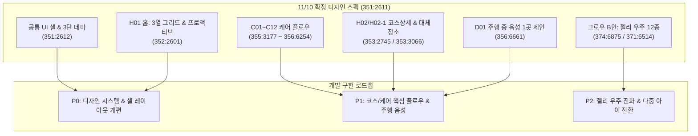
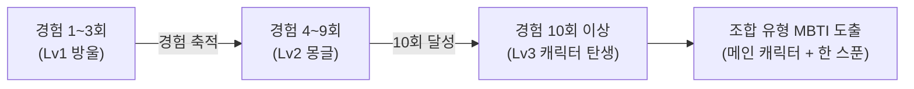
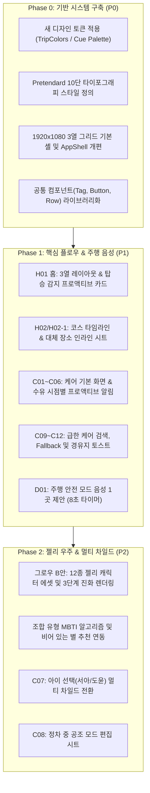

# 11/10 확정 Figma 디자인 심층 분석 및 개발 플랜
> **기준 파일**: Figma `xeLwkzhH8tnsazQdOriGU2`  
> **기준 페이지**: `종합 정리` (Node ID: `130:5`)  
> **대상 섹션**: `11/10 · Pleos 공통 UI + 지수ver` (Node ID: `351:2611`)  
> **문서 버전**: v1.0 (2026-11-10)  
> **작성자**: Pleos Connect 수석 아키텍트

---

## 1. 개요 및 분석 배경

본 문서는 플레오스(Pleos) IVI 공모전 출품작 **「오늘, 어디 가지?」(Pleos Connect / 시터노트)**의 최신 확정 디자인(11/10 배포본)을 심층 분석하고, 기존 코드베이스 대비 Gap Analysis 및 단계별 개발 로드맵을 정의한 기술 계획서입니다.

11/10 확정 디자인은 차량용 대화면(1920×1080) IVI 환경에 최적화된 **Pleos 공통 UI 셸 규격**, **네이버 Cue 계열 시터노트 팔레트**, **안전 주행 인터랙션 원칙(Drive On/Off 분리)**, 그리고 아이의 경험 데이터를 시각화하는 **그로우 B안(젤리 우주 12종 캐릭터 진화 시스템)**을 최종 확정하였습니다.



---

## 2. 공통 UI 셸 & 디자인 시스템 명세

### 2.1 윈도우 구조 및 주행 모드 테마 (351:2612)
- **전체 IVI 캔버스**: 1920 × 1080 px
- **시스템 영역 (Pleos OS)**:
  - 좌측/상단 차량 기본 UI(속도계, 클러스터, 미디어 독 등)가 배치되며 앱은 할당된 윈도우 영역에 렌더링
  - **시터노트 앱 윈도우 영역**: `1256 × 886 px` (기준 좌표: `x=652, y=76`)
  - 상단 핸들(Grabber): `80 × 6 px` (가운데 정렬 `x=588, y=10`)
- **오버레이 규칙 (디자이너 명시 원칙)**:
  > [!IMPORTANT]
  > 시트, 드롭다운, 토스트 등 모든 오버레이는 **시터노트 앱 영역(1256×886)만 어둡게(Dim) 처리**하며, 공통 차량 UI(차량 패널, 상태바, 독)는 절대 가리지 않고 원래 상태를 유지해야 합니다.
- **주행 모드 3단 테마 시스템**:
  | 심볼 ID | 모드 명칭 | 주행 상태 | 테마 | 용도 및 인터랙션 특성 |
  |---|---|---|---|---|
  | `351:2613` | `Theme=Light, Drive=Off` | 정차 중 (Parked) | 라이트 | 주간 기본 모드. 전체 리스트 탐색, 상세 설정, 텍스트 입력 가능 |
  | `351:2758` | `Theme=Dark, Drive=Off` | 정차 중 (Parked) | 다크 | 야간 및 **낮잠/수면 모드(C04)**. 저자극 앰비언트 UI |
  | `351:2903` | `Theme=Light, Drive=On` | 주행 중 (Driving) | 라이트 | 주행 안전 모드. 터치 조작 최소화, 1곳 음성 제안(D01) 전용 |

### 2.2 컬러 팔레트 (Palette · 시터노트 Naver Cue 계열, 358:5057)
기존의 초록색 중심 팔레트(`0xFF0E8A5F`)에서 **네이버 Cue 계열의 현대적인 인디고/블루/바이올렛 팔레트**로 전면 전환되었습니다.

| 색상 토큰 | HEX 코드 | Compose Color 선언 | 용도 |
|---|---|---|---|
| **Primary** | `#4D55F0` | `Color(0xFF4D55F0)` | 핵심 브랜드 컬러, 주요 CTA 버튼, 활성 탭 인디케이터 |
| **Blue** | `#1F80FF` | `Color(0xFF1F80FF)` | 경로 안내(Route), 길안내 링크, 확인 상태 |
| **Violet** | `#8A1EE6` | `Color(0xFF8A1EE6)` | 프리미엄 뱃지, 특별 케어 모드 강조 |
| **Soft** | `#EEEFFE` | `Color(0xFFEEEFFE)` | Primary 대비 연한 배경, 칩 선택 배경, 카드 하이라이트 |
| **Pink** | `#E9A6F7` | `Color(0xFFE9A6F7)` | 서아 프로필 강조, 수유 이벤트 하이라이트 |
| **Cyan** | `#22C3EE` | `Color(0xFF22C3EE)` | 날씨 맑음, 쾌적 공조 인디케이터 |
| **Periwinkle** | `#7E9BF5` | `Color(0xFF7E9BF5)` | 보조 그래프, 타임라인 레일 및 보조 텍스트 |
| **Cue Gradient** | `#1F80FF` → `#5B4BF5` → `#8A1EE6` | `Brush.horizontalGradient(...)` | 그로우 B안 젤리 우주 배경 및 탄생 축하 배너 |
| **Text Ink** | `#20252B` | `Color(0xFF20252B)` | 메인 텍스트 (명도 95% 이상 가독성) |
| **Text Ink Soft**| `#68727D` | `Color(0xFF68727D)` | 보조 캡션, 메타 정보, 단위 표기 |
| **Panel Surface**| `#F3F5F7` | `Color(0xFFF3F5F7)` | 앱 윈도우 배경 |
| **Card White** | `#FFFFFF` | `Color(0xFFFFFFFF)` | 카드 컴포넌트 배경 (CornerRadius: 16~24dp) |

### 2.3 타이포그래피 시스템 (Pretendard 위계, 357:1733)
차량 주행 환경의 시인성을 위해 Pretendard 폰트를 10개 위계로 엄격히 규격화하였습니다.

```
Display    : 56sp Bold   (수유 타이머 12:30, 핵심 시계)
Number     : 44sp Bold   (잔여 시간 2:45, 온도 24°)
Title 1    : 34sp Bold   (코스 타이틀 '덕수궁 나들이 코스')
Title 2    : 26sp Bold   (섹션 타이틀 '베이비케어 모드')
Title 3    : 22sp Bold   (장소명 '구리시 육아종합지원센터')
Button     : 20sp Bold   (주요 버튼 텍스트 '경유지 추가')
Body 1     : 20sp Medium (음성 발화 인식 텍스트 '“애 잔다” · “수유할게”')
Body 2     : 18sp Regular(안내 문구 '바꾸면 뒤 일정이 다시 계산돼요')
Label      : 16sp Medium (메타 정보 '1.2km · 3분 · 경로 위')
Caption    : 15sp Regular(정렬 기준 '경로 기준 · 거리순')
```

### 2.4 공통 컴포넌트 라이브러리 (Components · 오토레이아웃, 361:5000)
1. **Tag (`361:5009`)**:
   - `Type=Yes` (77×31px): Soft 연보라 배경 + Primary 텍스트
   - `Type=No` (77×31px): 연회색 배경 + InkSoft 텍스트
2. **Button (`361:5025`)**:
   - `Kind=Primary` (168×56px): Primary(#4D55F0) 배경 + 흰색 텍스트 (Title 20B)
   - `Kind=Soft` (168×56px): Soft(#EEEFFE) 배경 + Primary 텍스트
   - `Kind=Line` (171×59px): 투명 배경 + 1.5px Outline + Ink 텍스트
3. **Course Item (`361:5026`)** (360×155px): 코스 썸네일, 타이틀, 태그, 소요시간 및 경유지 표시
4. **Timeline Row (`361:5052`)** (752×123px): 타임라인 도착 시각, 장소명, 머무는 시간, 케어 시설 뱃지
5. **Place Row (`361:5138`)** (944×89px):
   - `Icon=Nursing`: 수유실 장소 행 (거리, 소요시간, 우회 시간)
   - `Icon=Parking`: 정차 공간 장소 행 (휴게소/졸음쉼터 정보)
6. **Voice Button (`368:5723`)** (44×44px): 마이크 아이콘 원형 버튼

---

## 3. 화면별 세부 기능 명세 및 Gap Analysis

### 3.1 H01 홈 — 오늘의 추천 코스 (`352:2601`)
#### 세부 구조
```
+-----------------------------------------------------------------------------------------------+
| [Grabber]                                                                                     |
| [Search/Voice Bar (940x64): VoiceBtn | Placeholder | Profile(서아) | NavTurn]  [Weather: 14° 맑음] |
| [Filter Chips (8종): 반나절 | 하루 | 반경10km v | 반려견 | 수유실 | 유모차 | 14개월 | 다시추천]      |
+------------------------------------+--------------------------+-------------------------------+
| Col 1: 지도 & 프로액티브 (392px)   | Col 2: 추천 리스트(392px)| Col 3: 상태 & 퀵독 (392px)    |
| - 코스 경로 미니맵 (마커 1, 2, 집)  | - 상단 퀵 바로가기 4개   | - [정차공간]    | [경험나무]   |
| - 상단 뱃지: "추천 1 미리보기"     | - 구분선                 | - [최근 방문 코스 3개 다시가기]|
| - 하단: [탑승 감지 프로액티브 카드]| - 오늘의 추천 코스 3개   |   (현대백화점/해변/아차산)    |
|   "토요일 09:45 탑승 감지"         |   (Course Item x 3)      | - [Nav 바로가기 독]           |
|   "아차산 숲길 반나절 어때요?"     |                          |   (홈 | 케어 | 그로우 | 설정)  |
|   [총 3시간 · 5대 가는 중 -> 출발] |                          |                               |
+------------------------------------+--------------------------+-------------------------------+
```

#### Gap Analysis
| 항목 | 기존 코드 (`HomeScreen.kt`) | 11/10 확정 Figma (`352:2601`) | 변경 작업 내용 |
|---|---|---|---|
| **화면 레이아웃** | 2열 수직 스크롤 (좌: 코스 3개, 우: 수유/나무) | **3열 정밀 IVI 그리드** (1열: 지도+프로액티브, 2열: 코스 리스트, 3열: 케어타일+최근방문+독) | `HomeScreen.kt` 3열 Row 레이아웃으로 전면 개편 |
| **상단 헤더** | 단순 텍스트 시각/날짜 표시 | **통합 검색/음성 바** + 날씨(14° 맑음 구리시) + 서아 프로필 원형 아바타 | `HomeHeader` 컴포넌트 신설 |
| **필터 칩** | 4~5개 단일 행 FlowRow | **8종 표준 규격 필터 칩** (반나절, 하루, 반경 10km 드롭다운, 반려견, 수유실 필수, 유모차, 생후 14개월, 코스 다시 추천) | `HomeFilterChips` 컴포넌트 교체 |
| **프로액티브 카드** | 없음 (단순 코스 카드만 존재) | **탑승 감지 프로액티브 추천 카드** (시간/날씨 감지, "아차산 숲길 반나절 어때요?", 퀵 내비 출발) | `ProactiveRecommendationCard` 구현 |
| **하단 네비게이션** | 좌측 고정 레일 (`SideMenu`) | **우측 3열 하단 통합 독 (`Nav · 바로가기`)** (홈/케어/그로우/설정) | 독 위치 및 전환 핸들러 연동 |

---

### 3.2 H02 / H02-1 코스 상세 및 대체 장소 (`353:2745`, `353:3066`)
#### 세부 구조
- **H02 코스 상세 (`353:2745`)**:
  - 상단: 타이틀("덕수궁 나들이 코스"), 서브("첫 이동 40분 · 지금 13대 가는 중"), 날씨(14° 맑음 서울 중구)
  - 요약 태그 5종: `총 5시간 30분`, `수유실 2곳`, `유모차 OK`, `주차 4곳 확인`, `반려동물 일부 불가`
  - 좌측 타임라인(800px): `Timeline · 코스 타임라인` (레일 라인 + 6개 장소 행, "↻ 교체 · ✕ 삭제 · ≡ 순서 변경")
  - 우측 패널(392px):
    - `Map · 코스 경로` (392×330px, 미니맵 및 경유지 넘버링)
    - `Status · 도착·수유` (도착 10:40 · 다음 수유 12:30 / "여유 1시간 50분 — 수유 전에 도착해요")
    - `Alt · 대안 장소 바로가기` ("휴무·마감이면 대안 장소로 바꿔요")
    - 하단 액션 버튼: `[코스 시작]` (대형 392×72px), `[경유지 편집]` (190px), `[코스 저장]` (190px)
- **H02-1 대체 장소 고르기 (`353:3066`)**:
  - 우측 패널이 `Alt sheet · 올데이 브런치 대체 장소`로 전환
  - 안내 문구: *"같은 시간대 · 경로에서 가까운 순 · 수유실·유모차 조건 유지"*
  - 후보 카드 3개:
    1. 국밥집 (0.6km · 경로에서 +2분, 체크 선택 상태)
    2. 순두부집 (1.1km · +4분, `[선택]` 버튼)
    3. 파스타집 (1.4km · +5분, `[선택]` 버튼)
  - 하단 안내: *"바꾸면 뒤 일정과 수유 지점 시간이 다시 계산돼요"*
  - 버튼: `[취소]` (190px), `[이걸로 바꾸기]` (190px Primary)

#### Gap Analysis
| 항목 | 기존 코드 (`CourseScreen.kt`, `CourseOverview.kt`) | 11/10 확정 Figma (`353:2745` / `353:3066`) | 변경 작업 내용 |
|---|---|---|---|
| **코스 메타 태그** | 단순 텍스트 나열 | **5대 핵심 케어 태그** 정량화 (총 시간, 수유실 수, 유모차 여부, 주차 면수, 반려동물) | `CourseConditionBadges` 리팩토링 |
| **타임라인 조작** | 단순 뷰 | **항목별 인라인 액션** (교체 버튼 누르면 우측에 H02-1 시트 팝업) | `TimelineItemRow`에 교체/삭제 이벤트 연결 |
| **대체 장소 시트** | 별도 대화상자 다이얼로그 | **우측 3열 인라인 슬라이드 시트** (H02-1) + 실시간 일정 재계산 연동 | `AltPlaceSelectSheet` 구현 |
| **도착/수유 여유 요약** | 분리된 텍스트 카드 | **`Status · 도착·수유` 일체형 카드** (도착 시간과 수유 시간 차이 계산 및 여유 텍스트 노출) | `ArrivalFeedingStatusCard` 구현 |

---

### 3.3 C01 ~ C12 케어 화면 전체 플로우 (`355:3177` ~ `356:6254`)
케어 탭은 **3열 기본 그리드 베이스** 위에 주행 상황 및 수유 시점에 따라 **우측 하단 가변 슬롯(392×370px) 및 오버레이 시트**가 동적으로 전환되는 반응형 구조입니다.

```
+-----------------------------------------------------------------------------------------------+
| [Grabber]                                                                                     |
| [Search/Voice Bar]                                                            [Weather: 14°]  |
| [Chips: 서아(14개월) v | 수유실 | 기저귀교환대 | 정차공간 | 화장실 | 소아과 | 약국]               |
+--------------------------------+------------------------------+-------------------------------+
| Col 1: 베이비케어 모드 (392px) | Col 2: 수유&단골장소 (392px) | Col 3: 급한케어 & 상황별 슬롯 |
| - 토글 On/Off                  | - [Card · 수유 타이머]       | - [수유실 타일] | [정차 타일] |
| - 실내온도 23° / 목표 24°      |   Display 시각: 12:30        +-------------------------------+
| - [mode/sleep] 낮잠·수면 모드  |   마지막 09:30 · 간격 3시간  | [가변 상황별 카드 / 시트 영역] |
|   (23°C · 미풍 · 최소음량)     |   프로그레스 바              | C01: 도착 지연 알림 배너      |
| - [mode/feed] 수유 정차 모드   |   [지금 수유했어요 버튼]     | C02: 오늘 케어 첫 기록 전     |
|   (24°C · 송풍 · 정차 시)      +------------------------------+ C05: 수유 임박 (15분 전)      |
| - [Link · 모드 편집] (정차 중) | - [Card · 자주 가는 케어장소]| C06: 수유 시간 지남           |
|                                |   구리시 육아종합지원센터    | C12: 다음 경유지 카드         |
|                                |   OO몰 2F 수유실             | (C08~C11은 시트로 앱 영역 덮음)|
+--------------------------------+------------------------------+-------------------------------+
```

#### C01~C12 상황별 상세 스펙표
| 번호 | 화면 명칭 | 트리거 조건 | 가변 슬롯 / 오버레이 내용 | 액션 및 기획 규칙 |
|---|---|---|---|---|
| **C01** | 도착 지연 알림 (`355:3177`) | 실시간 교통 정체 발생 (도착 > 다음 수유) | `Proactive · delay` 카드:<br>• *"정체로 도착이 12:45로 늦어져요"*<br>• *"다음 수유(12:30) 전 들를 곳 경로 위 2곳"*<br>• OO몰(+3분), △△휴게소(+6분) | `[경유지 추가]` 누르면 C12 배너 표시 후 경로 재설정<br>`[그대로 가기]` 누르면 닫힘 |
| **C02** | 첫 기록 전 (`355:3567`) | 당일 수유 기록이 없는 초기 상태 | `Card · 오늘 케어 기록`:<br>• *"아직 기록이 없어요"*<br>• *"마지막 수유를 알려 주면 미리 챙겨 드려요"*<br>• *"웹앱 C02 기록과 동기화"* | `[지금 수유했어요]` 누르면 타이머 시작 |
| **C03** | 수유 정차 모드 (`355:3942`) | 차량 정차(P단) + 수유 모드 켬 | Col 1 `mode/feed` 활성화 강조:<br>• 24°C 유지, 직접 바람 없는 송풍, 실내 소음 차단 | 시동 켜진 정차 중에만 동작 |
| **C04** | 낮잠·수면 모드 (`355:4322`) | 아이 취침 감지 or 수면 모드 켬 | **전체 화면 `Theme=Dark` 전환**:<br>• 23°C, 미풍, BGM 볼륨 최소(10%) | 저자극 앰비언트 다크 테마 적용 |
| **C05** | 수유 15분 전 (`355:4702`) | `다음 수유 - 현재 시간 <= 15분` | `Proactive · soon` 카드:<br>• *"15분 뒤 수유 시간이에요"*<br>• 경로 위 최적 수유실 2곳 추천 | `[경유지 추가]` / `[나중에]` |
| **C06** | 수유 시간 지남 (`355:5094`) | `현재 시간 > 다음 수유` | `Proactive · over` 경고 카드 (Amber/Red):<br>• *"수유 시각이 10분 지났어요"*<br>• 최단거리 수유실 즉시 안내 | `[수유실 경유지 추가]` (강조 버튼) |
| **C07** | 아이 선택 (`356:4041`) | 상단 `Child selector` 클릭 (정차 중) | `Dropdown · 아이 목록` (서아 14개월 vs 도윤 38개월):<br>• 도윤: 수유 없음, 낮잠 1회, 멀미 주의 | 선택 즉시 케어 화면 전체 기준 변경<br>주행 중엔 음성으로 *"도윤이로 바꿔줘"* |
| **C08** | 모드 편집 (`356:4452`) | `Link · 모드 편집` 클릭 (정차 중) | `Sheet · 모드 편집` (앱 영역 모달):<br>• 기본/수면/수유 모드별 온도(23~24°C), 풍량(미풍/약/중), 음량(10/30%) 슬라이더 | 정차 중에만 편집 가능 (웹앱 동기화) |
| **C09** | 급한 수유실 (`356:4897`) | `Tile · 급한 케어 수유실` 클릭 | `Sheet · 수유실 3곳`:<br>• 한국관광공사 무장애 정보 + 단골 장소<br>• 거리순, 경로 우회시간 표기 | 음성으로 *"첫 번째"* 선택 지원 |
| **C10** | 수유실 없음 (`356:5359`) | 반경 10km 내 수유실 미등록/실패 | `Sheet · 결과 없음`:<br>• *"근처에 수유실이 없어요"*<br>• **차 안 수유 가능한 정차 공간 3곳 자동 fallback** | 정차 시 수유 정차 모드 자동 제안 |
| **C11** | 급한 정차공간 (`356:5796`) | `Tile · 급한 케어 정차 공간` 클릭 | `Sheet · 정차 공간 3곳`:<br>• 휴게소, 졸음쉼터, 공영주차장 (갓길 제외) | 공공데이터 API 연동 |
| **C12** | 경유지 완료 (`356:6254`) | 경유지 추가 완료 시점 | `Card · 다음 경유지` 슬롯 교체 +<br>`Toast · 경유지 추가 완료` (하단 토스트: *"OO몰 2F 수유실 추가 +3분 [되돌리기]"*) | K6 규격 완료 배너 및 내비 동기화 |

---

### 3.4 D01 주행 중 음성 1곳 제안 (`356:6661`)
차량 주행 중(Drive On, 속도 > 0 km/h) 운전자의 인지 부하를 최소화하기 위한 안전 주행 전용 화면입니다.

#### 세부 구조 및 인터랙션 규칙
- **트리거**: 주행 중 핸들 마이크 버튼 또는 음성 바를 통해 *"수유실 찾아줘"*, *"애 운다"*, *"기저귀 갈아야 해"* 등의 발화 수신
- **UI 배치**: 복잡한 목록 대신 우측 하단에 `Voice · 주행 중 제안 (356:7052)` 카드만 컴팩트하게 노출
  - 발화 인식: `“수유실 찾아줘”`
  - 시스템 음성 TTS 피드백: *“가장 가까운 OO몰 2F 수유실이에요. 경로에서 3분 더 걸려요. 경유지로 추가할까요?”*
  - 단일 추천 장소 카드: `OO몰 2F 수유실` (1.2km · 경로에서 +3분 · 유모차 · 주차 확인)
  - 운전 중 조작 가능한 대형 버튼 2개: `[좋아 · 추가]` (Primary), `[아니요]` (Soft Line)
- **안전 규칙 (Safety Timeout)**:
  > [!CAUTION]
  > 주행 중 시선 분산을 방지하기 위해 음성 안내 후 **8초 동안 운전자의 응답(음성 또는 터치)이 없으면 제안 카드가 자동으로 닫힙니다**.

#### Gap Analysis
| 항목 | 기존 코드 (`VoicePanel.kt`) | 11/10 확정 Figma (`356:6661`) | 변경 작업 내용 |
|---|---|---|---|
| **화면 점유** | 전체 화면을 덮는 반투명 패널 (앱 전체 조작 차단) | **우측 3열 인라인 카드 형태** (운전 시야 방해 최소화) | `DrivingVoiceCompactCard` 구현 |
| **추천 방식** | 여러 장소 목록 노출 | **무조건 최우선 1곳만 선정하여 제안** | 1개 장소 음성 추천 알고리즘 및 UI 작성 |
| **자동 닫힘** | 수동 닫기 버튼만 제공 | **8초 안전 타이머 카운트다운 및 자동 닫힘** | Coroutine 기반 8초 타이머 핸들러 구현 |

---

### 3.5 그로우 & 젤리 우주 B안 (`374:6875`, `374:7543`, `374:6476`, `371:6514`)
기존의 단순 그래프(나무/별자리)에서 아이의 경험 데이터를 바탕으로 젤리 생명체가 성장하는 **게이미피케이션 B안(젤리 우주)**으로 확정되었습니다.



#### 12개 경험 카테고리 & 12종 젤리 캐릭터 매핑
| 번호 | 카테고리 명칭 | 배정 젤리 캐릭터 | Lv1 (1~3회) | Lv2 (4~9회) | Lv3 (10회 이상) 탄생 명칭 |
|---|---|---|---|---|---|
| 1 | **전시·미술** | **유니콘** | 유니콘 방울 | 유니콘 몽글 | 상상의 유니콘형 |
| 2 | **과학·박물관** | **공룡** | 공룡 방울 | 공룡 몽글 | 호기심 공룡형 |
| 3 | **자연·숲** | **곰** | 곰 방울 | 곰 몽글 | 푸근한 숲 곰형 |
| 4 | **동물·교감** | **강아지** | 강아지 방울 | 강아지 몽글 | 다정한 강아지형 |
| 5 | **물놀이** | **카피바라** | 카피바라 방울 | 카피바라 몽글 | 느긋한 카피바라형 |
| 6 | **몸놀이** | **말** | 말 방울 | 말 몽글 | 씩씩한 달리는 말형 |
| 7 | **음악·공연** | **고양이** | 고양이 방울 | 고양이 몽글 | 감성 고양이형 |
| 8 | **책·이야기** | **웜뱃** | 웜뱃 방울 | 웜뱃 몽글 | 똑똑한 웜뱃형 |
| 9 | **맛 탐험** | **햄스터** | 햄스터 방울 | 햄스터 몽글 | 미식가 햄스터형 |
| 10 | **친구·어울림** | **펭귄** | 펭귄 방울 | 펭귄 몽글 | 골목대장 펭귄형 |
| 11 | **만들기** | **비버** | 비버 방울 | 비버 몽글 | 뚝딱이 비버형 |
| 12 | **여행·탐험** | **수달** | 수달 방울 | 수달 몽글 | 모험가 수달형 |

#### 성장 규칙 및 운영 정책
1. **경험 집계 규칙**: 방문 1회 = 경험 1개. **장소에 10분 이상 체류** 시 해당 장소의 메인 카테고리로 자동 집계.
2. **조합 유형 산출 (MBTI식 수식어)**:
   - 1위 카테고리 = 메인 캐릭터
   - 2위 카테고리 = "한 스푼" 보조 수식어
   - *예시: 전시·미술(1위, 유니콘) + 자연·숲(2위, 곰) = **"전시를 좋아하는 상상의 유니콘형 + 숲 곰 한 스푼 · '숲에서 그림을 그리는 아이'"***
   - *예시: 과학(공룡) + 책(웜뱃) = **"책으로 공룡을 파는 꼬마 박사"***
3. **균형 알림 (Balance Alert)**: 특정 카테고리가 전체 경험의 50%를 초과할 경우 우측에 `Card · 아직 비어 있는 별을 키워볼까요?` 카드를 노출하여 부족한 카테고리의 주변 장소(과학관, 클래스 등) 추천.
4. **롤링 윈도우**: 최근 6개월간의 경험 데이터를 기준으로 유형을 지속적으로 재계산.
5. **캐릭터 탄생 축하 연출 (`374:7543`)**:
   - 정차 중: `Sheet · 캐릭터 탄생` 풀 모달 노출 (축하 일러스트, 획득 역량 설명: *"보고, 생각하고, 말로 꺼내는 힘이 자라요"*)
   - 주행 중: 운전 방해 방지를 위해 화면 팝업 없이 음성으로만 *“서아의 유니콘 캐릭터가 태어났어요”* 1회 안내.

---

## 4. 우선순위 기반 단계별 개발 로드맵



### 마일스톤별 상세 일정 및 배정
| 마일스톤 | 우선순위 | 작업 항목 | 대상 파일 | 검증 기준 |
|---|---|---|---|---|
| **M1: 디자인 토큰 & 공통 셸** | **P0** | • Cue 컬러 팔레트 선언<br>• Pretendard 10종 텍스트 스타일<br>• AppShell 3열 프레임워크<br>• 공통 Button/Tag/Row | `ui/Theme.kt`<br>`ui/Common.kt`<br>`ui/AppShell.kt` | Figma 공통 UI 셸(`351:2612`)과 컴포넌트 규격 1:1 일치 |
| **M2: H01 홈 & H02 코스 상세** | **P1** | • H01 3열 그리드 + 검색바<br>• 탑승 감지 프로액티브 카드<br>• H02 타임라인 레일 + 5종 태그<br>• H02-1 대체 장소 선택 및 재계산 | `ui/HomeScreen.kt`<br>`ui/CourseScreen.kt`<br>`ui/CourseOverview.kt` | 홈 화면에서 코스 선택 → 대체 장소 교체 → 시간 재계산 정상 동작 |
| **M3: C01~C12 케어 플로우** | **P1** | • 베이비케어 23/24° 공조 토글<br>• 수유 타이머 프로그레스 바<br>• C01 지연 알림 배너<br>• C05/C06 수유 임박/초과 알림<br>• C09~C11 급한 케어 & C12 완료 토스트 | `ui/CareScreen.kt`<br>`ui/FeedingCard.kt`<br>`ui/DelayAlertPanel.kt`<br>`care/CareManager.kt` | 수유 시간에 따른 가변 슬롯 자동 전환 및 경유지 추가 연동 |
| **M4: D01 주행 안전 음성** | **P1** | • 주행 모드(Drive On) 감지<br>• 우측 하단 1곳 전용 카드<br>• 8초 자동 닫힘 타이머<br>• TTS 피드백 음성 출력 | `ui/VoicePanel.kt`<br>`voice/VoiceManager.kt` | 차량 주행 중 발화 시 1곳만 제시되고 8초 후 자동 닫힘 검증 |
| **M5: 그로우 B안 젤리 우주** | **P2** | • 12종 캐릭터 진화 로직(Lv1~3)<br>• MBTI 조합 유형 자동 생성<br>• 정차 중 탄생 축하 모달<br>• 비어 있는 별 장소 추천 연동 | `ui/ExperienceUniverse.kt`<br>`ui/ExperienceScreen.kt`<br>`server/app/visits.py` | 방문 횟수(10회) 달성 시 탄생 애니메이션 및 서버 API 동기화 |
| **M6: 멀티 차일드 & 모드 편집** | **P2** | • C07 아이 선택 드롭다운<br>• 서아/도윤 프로필 실시간 전환<br>• C08 정차 중 공조 모드 편집 시트 | `ui/CareScreen.kt`<br>`data/FamilyProfile.kt` | 아이 변경 시 타이머/모드 기준 즉시 변경 및 P단 해제 시 잠금 |

---

## 5. 안드로이드(Compose) & 백엔드(FastAPI) 연동 요구사항

### 5.1 안드로이드 클라이언트 구현 요구사항
1. **상태 관리 (`TripViewModel.kt`, `CareState.kt`)**:
   - `DriveState`: 차량 속도 및 기어(P단 여부)에 따른 `DriveMode(ON, OFF)` 관리
   - `CareSituation`: 수유 잔여 시간 및 경로 지연 상태를 감지하여 `C01(Delay), C05(Soon), C06(Over), Normal` 상태 자동 발행
   - `SelectedChild`: 현재 활성 아이 프로필 상태 관리 (서아 14개월 / 도윤 38개월)
2. **컴포저블 분리 및 신규 생성**:
   - `ui/components/SitterNoteHeader.kt`: 상단 검색바 + 날씨 + 아바타
   - `ui/home/ProactiveCard.kt`: H01 탑승 감지 카드
   - `ui/course/AltPlaceSheet.kt`: H02-1 대체 장소 선택 시트
   - `ui/care/CareProactiveSlot.kt`: C01/C05/C06 가변 카드 렌더러
   - `ui/care/UrgentCareSheet.kt`: C09/C10/C11 급한 케어 바텀시트
   - `ui/grow/JellyUniverseView.kt`: B안 12종 젤리 우주 캔버스

### 5.2 백엔드 API 신규 및 확장 요구사항 (`server/app/`)
1. **젤리 우주 B안 집계 API (`GET /api/grow/jelly-universe`)**:
   - 12개 카테고리별 최근 6개월 방문 횟수 반환
   - 각 카테고리별 성장 단계(`level`: 1, 2, 3) 및 현재 경험 수 계산
   - 대표 조합 유형 도출 (1위 캐릭터 + 2위 "한 스푼" 수식어 텍스트)
   - 부족 카테고리 추천 장소 목록(`empty_stars`) 포함
2. **경로 기반 수유실/정차공간 Fallback API (`GET /api/care/urgent`)**:
   - 쿼리 파라미터: `lat`, `lon`, `route_polyline`, `kind` (`nursing` 또는 `parking`)
   - 경로 우회 시간(+N분) 및 무장애 시설 정보(한국관광공사 데이터) 반환
   - 수유실 결과가 0건일 경우 자동으로 `fallback_parkings` 배열 함께 반환 (C10 요구사항)
3. **대체 장소 교체 및 일정 재계산 API (`POST /api/course/replace-place`)**:
   - 기존 장소 ID와 대체 장소 ID를 수신하여 코스 경로 및 타임라인 재계산
   - 변경된 도착 예정 시각 및 다음 수유 시각과의 갭 재산출 반환
4. **웹앱-차량 동기화 API (`POST /api/sync/mode-settings`)**:
   - C08에서 수정한 베이비케어 공조 설정(온도, 풍량, 음량)을 저장하고 웹앱 MY 화면에 실시간 동기화

---

## 6. 결론 및 향후 액션 플랜

Figma `11/10 · Pleos 공통 UI + 지수ver` 디자인은 기존에 다소 분산되어 있던 모바일 웹앱과 차량 IVI 간의 경계를 명확히 짓고, 차량 환경에 특화된 1920×1080 3열 그리드 레이아웃과 주행 안전 인터랙션 규칙을 정립하였습니다.

향후 개발은 **M1(디자인 토큰 및 3열 셸)**을 신속히 선제 구축한 뒤, **M2(홈/코스)와 M3(케어 플로우), M4(주행 음성 제안)**을 순차적으로 병렬 구현하는 전략으로 공모전 출품 완성도를 극대화할 것입니다.
